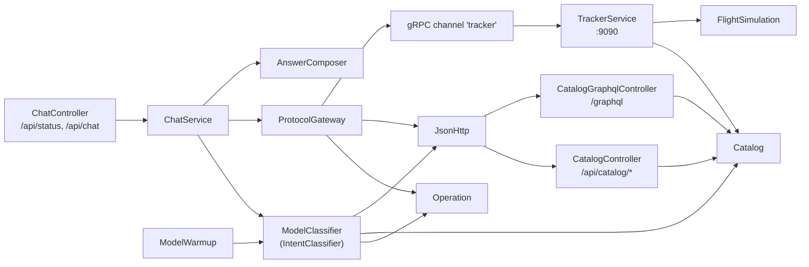
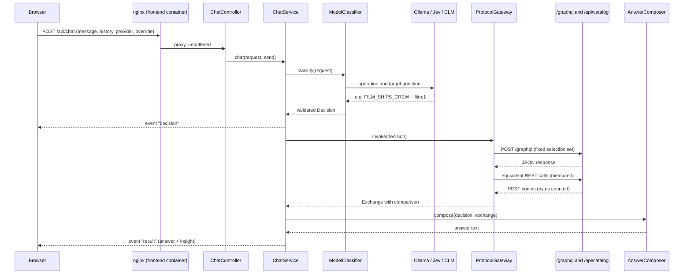
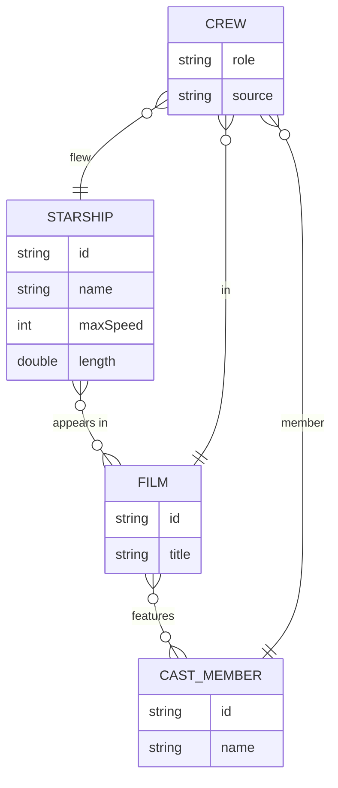
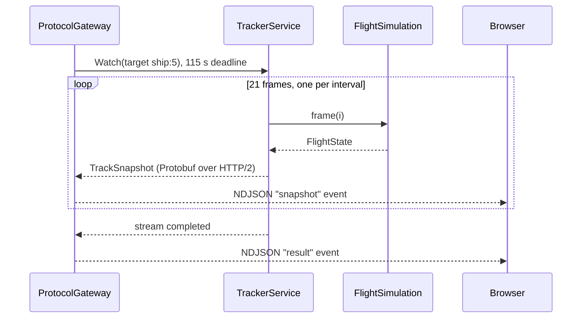
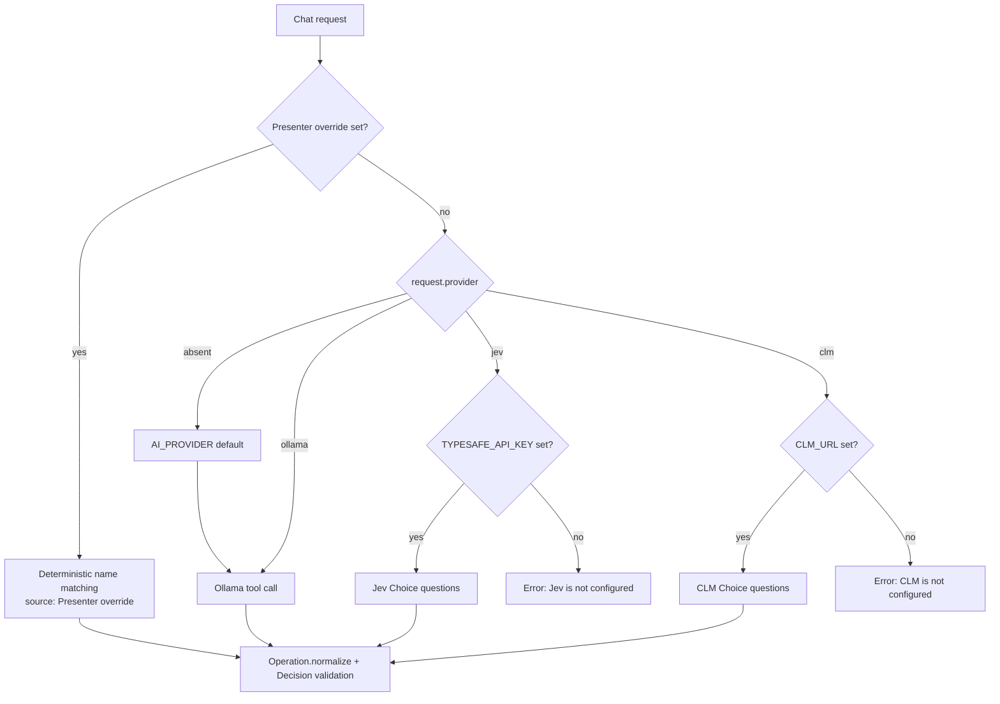
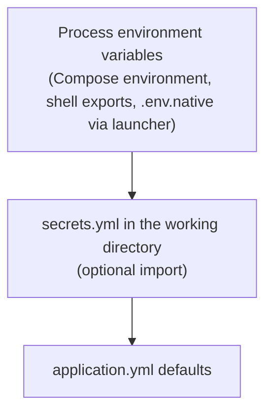

# Protocol Studio Backend Study Guide

This guide explains how the Protocol Studio backend is built, how a question travels through it and back to the browser, how the three AI routers (Ollama, Jev and CLM) make their decisions, and how to configure Jev and CLM. It is written for developers who are new to the codebase and want to understand it well enough to change it safely.

The backend is a single Spring Boot application. It serves a REST API, a GraphQL API and a native gRPC service from one shared, immutable catalog of Star Wars data. A chat endpoint asks an AI router which reviewed operation answers a question, then calls the matching protocol endpoint on itself with real traffic and streams the result to the browser.

> [!NOTE]
> The AI never answers questions and never writes URLs or query text. It only chooses one reviewed operation and one allowlisted catalog target. Every answer is composed from the response the selected protocol actually returned.

## 1. How the backend was built

### Technology stack

| Technology | Version | Role in the backend |
|---|---|---|
| Java | 25 | Language and runtime. Virtual threads are enabled for request handling and the gRPC stream worker. |
| Spring Boot | 4.1.1 | Application framework, configuration binding, embedded Tomcat on port 8080. |
| Spring Web MVC | via Spring Boot | REST endpoints and the streaming `/api/chat` endpoint. |
| Spring for GraphQL | via Spring Boot | The `/graphql` endpoint, schema-first from `schema.graphqls`. |
| Spring gRPC | via Spring Boot starters | The native gRPC server on port 9090 and the client channel the gateway uses. |
| Protocol Buffers | via `protobuf-maven-plugin` | Generates Java classes from `catalog.proto` at build time. |
| Jackson 3 | via Spring Boot (`tools.jackson`) | JSON parsing and the JSON tree payloads captured for the inspector. |
| Java `HttpClient` | JDK | Outbound HTTP to Ollama, Jev, CLM and the backend's own REST and GraphQL endpoints. |
| Bean Validation | via Spring Boot | Validates chat requests (message length, history size, roles). |
| Spring Boot Actuator | via Spring Boot | `/actuator/health`, used by the Docker health check. |
| JUnit 5, Mockito, AssertJ | via Spring Boot test | Unit and integration tests. |
| Spotless with google-java-format (AOSP style) | Maven plugin | Fails the build when code is not formatted. |
| Maven Wrapper | `./mvnw` | Builds without a local Maven install. |

### Project layout

All Java sources live in the `com.insight.router` package under `backend/src/main/java`. The table groups them by responsibility.

| File | Responsibility |
|---|---|
| `RouterApplication.java` | Spring Boot entry point. |
| `RouterProperties.java` | Binds the `router.*` settings (provider, model names, URLs and keys) and resolves the model for each provider. |
| `ChatController.java` | `GET /api/status` and `POST /api/chat`. Streams newline-delimited JSON (NDJSON) events. |
| `ChatModels.java` | The request, decision, exchange, comparison, timing and event records shared across the flow. |
| `ChatService.java` | Orchestrates one chat turn: classify, invoke the protocol, compose the answer, measure timings. |
| `IntentClassifier.java` | The routing interface. `ModelClassifier` is its only implementation. |
| `ModelClassifier.java` | Calls Ollama, Jev or CLM, or applies a presenter override, and returns a validated `Decision`. |
| `Operation.java` | The reviewed operations: protocol, accepted target kinds, GraphQL selection set, REST paths and REST equivalents. |
| `ProtocolGateway.java` | Executes the decision with real REST, GraphQL or gRPC traffic and captures the payloads. |
| `AnswerComposer.java` | Builds the answer text from the captured response only. |
| `Catalog.java` | Loads `catalog.json` once into immutable records and answers target queries. |
| `CatalogController.java` | REST resources under `/api/catalog` and the GraphQL query resolvers. |
| `TrackerService.java` | The gRPC `StarshipTracker` service (`Watch` server streaming and `Track` bidirectional streaming). |
| `FlightSimulation.java` | The scripted, clearly fictional Falcon flight that `Watch` streams. |
| `JsonHttp.java` | Small JSON HTTP client with a 5 second connect timeout and a 120 second request timeout. |
| `ModelWarmup.java` | Primes the local Ollama model in the background after startup. |
| `ProviderUnavailableException.java` | Raised when the selected provider is not configured; its message is shown to the user. |
| `ApiErrors.java` | Turns invalid requests into a uniform HTTP 400 problem response. |

| Resource | Responsibility |
|---|---|
| `src/main/resources/application.yml` | All configuration defaults and their environment variable names. Imports an optional `secrets.yml`. |
| `src/main/resources/catalog.json` | The canonical seed: 19 starships, 6 films, 18 cast members and documented crew records. |
| `src/main/resources/falcon-flight.json` | The 21 frames of the simulated Falcon flight. |
| `src/main/resources/graphql/schema.graphqls` | The GraphQL schema. |
| `src/main/proto/catalog.proto` | The gRPC service and message definitions. |
| `Dockerfile` | Two-stage build: `mvn verify` in a Maven image, then a JRE image running as a non-root user. |

### Main components

The diagram shows how the Spring components depend on each other. The orchestrator in the middle owns no protocol logic; it delegates to the classifier, the gateway and the composer.

### Rules the code follows

These rules are deliberate design decisions. Most are enforced by code or tests, so breaking one usually fails the build.

| Rule | Where it is enforced | Why it exists |
|---|---|---|
| Routers choose only an operation and a target from closed lists. | Ollama tool enums, Jev/CLM criteria, `Decision` validation | The model can never inject a URL, a query or a service name. |
| An operation and target must agree in kind. | `Decision` constructor and `Operation.normalize` | A mismatch such as REST with a crew target is corrected structurally or rejected, never guessed. |
| No hidden keyword fallback for automatic routing. | `ModelClassifier` | If a provider fails, the user sees an error instead of keyword routing labelled as AI. |
| Presenter overrides are explicit and labelled. | `ModelClassifier` override branch | Overrides use simple name matching and report the source as "Presenter override". |
| Answers come only from the transport response. | `AnswerComposer` | The model cannot invent facts. Wrong routes are visible because the answer reflects what was fetched. |
| Every protocol call is real traffic. | `ProtocolGateway` | The gateway calls its own HTTP endpoints and gRPC listener, never controller methods directly. |
| GraphQL fetches only what the operation needs. | `Operation` selection sets | The demo shows GraphQL's real benefit, and the REST comparison proves it. |
| The catalog is immutable and validated at startup. | `Catalog` constructor | Broken references (crew on a ship that is not in the film) stop the application from starting. |
| Secrets never leave the server. | `ChatController.status` | `/api/status` reports only whether a provider is configured, never URLs or keys. |
| The flight is fiction and says so. | `FlightSimulation`, `AnswerComposer` | Simulated pilots and locations are never presented as canon or live telemetry. |

### Build and quality gates

| Command | What it checks |
|---|---|
| `./mvnw verify` (from `backend/`) | Compiles, generates Protobuf classes, runs all tests and runs the Spotless format check. |
| `./mvnw spotless:apply` | Reformats code to google-java-format AOSP style. |
| `npm run check:backend` (from the repository root) | Runs `verify` through the project launcher. |
| `docker compose build backend` | Runs `mvn verify` inside the image build, so an unformatted or failing change cannot be packaged. |

> [!TIP]
> There is no local Java requirement if you only use Docker. To run the backend checks without installing Java, mount `backend/` into the `maven:3.9.11-eclipse-temurin-25` image and run `mvn verify` there.

## 2. How data flows from the backend to the frontend

### The request lifecycle

The browser posts a question to `/api/chat`. In Docker, nginx in the frontend container proxies `/api/` to the backend with buffering turned off, so each streamed event reaches the browser immediately. The sequence below follows one automatic (AI-routed) GraphQL question.

### The NDJSON event stream

`/api/chat` returns `application/x-ndjson`: one JSON object per line, flushed as it is produced. The controller flushes the servlet response after every line because Spring 7 suppresses body-stream flushes by default.

| Event type | When it is sent | Payload |
|---|---|---|
| `decision` | As soon as the router decides | The `Decision`: protocol, operation, target, source, reason and the raw classification. |
| `snapshot` | Once per gRPC stream message (gRPC only) | One decoded `TrackSnapshot`, including flight state when simulated, plus `meta`: the message's sequence, serialized Protobuf bytes and arrival time since the stream opened. |
| `result` | When the answer is ready | The answer text plus the `Insight`: decision, exchange and timings. |
| `error` | When anything fails | A user-facing message. Provider configuration errors pass through; other failures use a generic message. |

### The routing contract: operations

An operation is the unit the router chooses. Each operation fixes its protocol, the kinds of target it accepts and, for GraphQL, the exact selection set. A cast-only film question selects the film resource. A combined ships-and-cast question selects both explicitly, without fetching crew or ship specs.

| Operation | Protocol | Targets | Request sent | REST equivalent (GraphQL only) |
|---|---|---|---|---|
| `STARSHIP` | REST | `ship:N`, `all`, `none` | `GET /api/catalog/starships/{target}` | — |
| `FILM` | REST | `film:N` | `GET /api/catalog/films/{id}` (includes cast) | — |
| `CHARACTER` | REST | `cast:N` | `GET /api/catalog/cast/{id}` | — |
| `SHIPS_IN_FILM` | GraphQL | `film:N`, `none` | `query ShipsInFilm` (film title, ship names) | starships-in-film (embeds films and cast), 1 call |
| `FILM_SHIPS_CAST` | GraphQL | `film:N`, `none` | `query FilmShipsCast` (film title, character names, ship names) | starships-in-film (embeds films and cast), 1 call |
| `FILM_SHIPS_CREW` | GraphQL | `film:N`, `none` | `query FilmShipsCrew` (ships and their crew roles) | starships-in-film (embeds films and cast), 1 call |
| `SHIP_FILMS` | GraphQL | `ship:N`, `none` | `query ShipFilms` (films and cast names) | one starship, 1 call |
| `SHIP_CREW` | GraphQL | `crew:SHIP:FILM`, `none` | `query ShipCrew` (crew records only) | starship crew filtered by the same film target, 1 call |
| `CHARACTER_FILMS` | GraphQL | `cast:N`, `none` | `query CharacterFilms` (character, films, ships) | character, films and starships, 3 calls |
| `COMPARE_STARSHIPS` | GraphQL | `all`, `none` | `query CompareStarships` (name, speed, length) | all starships, 1 call |
| `TRACK` | gRPC | `ship:N` (overrides accept any target) | `StarshipTracker/Watch` server stream | — |
| `CREW_RECORDS` | REST | `crew:SHIP:FILM` | `GET /api/catalog/starships/{target}` | — (presenter overrides only) |

> [!IMPORTANT]
> `CREW_RECORDS` is never offered to a model. It exists so a presenter can force REST for a crew question. `TRACK` is offered to models with ship targets only, but presenter overrides may stream any target.

### Catalog targets

| Target | Meaning | Example |
|---|---|---|
| `ship:N` | One starship, N from 1 to 19 | `ship:5` is the Millennium Falcon |
| `film:N` | One film, N from 1 to 6 | `film:1` is A New Hope |
| `cast:N` | One character, N from 1 to 18 | `cast:1` is Luke Skywalker |
| `crew:SHIP:FILM` | Who flew one ship in one film, or `all` films | `crew:5:1` is the Falcon in A New Hope |
| `all` | The whole catalog | Broad listings and comparisons |
| `none` | Anything outside the catalog | Star Trek or the USS Enterprise |

### The catalog data model

`Catalog` loads `catalog.json` once at startup, resolves every ID into shared immutable records and validates every reference. Cast means fictional characters, never actors. Crew records are explicit and film-specific; appearing in a film never implies piloting a ship.

### The three protocol paths

**REST.** The gateway builds the path from the operation, sends a `GET` to its own `/api/catalog` resource, and captures the URL and response body. Starship reads return `Cache-Control: max-age=300`. REST resources return full nested objects, which is exactly why the GraphQL comparison is meaningful.

**GraphQL.** The gateway posts the operation's fixed query with one variable, `target`. If the response contains `errors`, the turn fails. After the GraphQL call it makes the operation's equivalent REST calls, which are real requests to real resources, and records their paths, total response bytes and duration as the `comparison`. The GraphQL protocol time excludes the comparison calls.

**gRPC.** The gateway opens the `tracker` channel and calls `Watch` with the target. For the Millennium Falcon the server streams 21 simulated flight frames, paced by `DEMO_FLIGHT_INTERVAL_MS` (2,000 ms by default, about 40 seconds). Only the first message carries the ship record; messages 2 to 21 carry just the changing flight state, which cut the stream from about 20,300 to about 7,100 bytes. Any other target returns one catalog snapshot. Each message is decoded to JSON and sent to the browser as a `snapshot` event, with its size and arrival time, the moment it arrives. The same per-message facts are kept in `exchange.stream` for the inspector's gRPC messages timeline.

> [!NOTE]
> The `Track` bidirectional method is still in `catalog.proto` and `TrackerService`, but the chat flow uses `Watch`. A server-owned timeline is easier to present and to cancel cleanly.

### What the inspector receives

| Field | Source | Meaning |
|---|---|---|
| `decision.source` | `ModelClassifier` | Which router decided, for example "Ollama · qwen3:4b-instruct-2507-q4_K_M" or "Presenter override". |
| `decision.reason` | `Operation.reason()` | Why this protocol fits, shown as "Why this protocol". |
| `decision.classification` | Raw router output | The Ollama tool call, or Jev/CLM answers including confidence and probabilities. |
| `exchange.request` / `exchange.response` | `ProtocolGateway` | The payloads captured at invocation time. gRPC messages are decoded through Protobuf `JsonFormat`. |
| `exchange.responseBytes` | `ProtocolGateway` | HTTP response body bytes, or serialized Protobuf message bytes. Framing and headers are excluded. |
| `exchange.comparison` | `ProtocolGateway` | GraphQL only: REST calls, total REST body bytes and their duration. |
| `exchange.stream` | `ProtocolGateway` | gRPC only: one entry per stream message with sequence, serialized bytes and arrival time. |
| `timings.routingMs` | `ChatService` | Time spent in the router. |
| `exchange.durationMs` | `ProtocolGateway` | Time spent in the protocol call. |
| `timings.totalMs` | `ChatService` | Total server time before the result is written. |

> [!WARNING]
> These timings are request diagnostics, not a protocol benchmark. The gRPC time includes deliberate pacing between flight frames, and routing time depends on hardware and on whether the model is warm.

### Errors and limits

| Situation | What happens |
|---|---|
| Invalid request (blank message, over 2,000 characters, over 20 history turns, bad role or provider) | `ApiErrors` returns HTTP 400 with a problem detail. |
| Selected provider not configured | `ProviderUnavailableException`; its message is sent as an `error` event. |
| Router returns no tool call, several tool calls, an unknown operation or an unsupported target | The turn fails with a generic `error` event. Nothing falls back. |
| Upstream HTTP 4xx or 5xx, or unreachable service | `JsonHttp` raises an error; the turn fails with a generic `error` event. |
| Browser disconnects | Writing the next event fails, the gRPC call is cancelled and the turn stops. |
| Timeouts | 5 s connect and 120 s request for HTTP; 115 s deadline for the gRPC stream; 300 s for the async request. |

## 3. The AI routers: Ollama, Jev and CLM

All three routers answer the same question: which reviewed operation, with which target, answers the latest message? They share one set of routing rules (`ModelClassifier.ROUTING_RULES`) and the same per-operation descriptions, so a question should route the same way regardless of provider. They differ in how they are asked and where they run.

| | Ollama | Jev | CLM |
|---|---|---|---|
| What it is | A local LLM runtime used for genuine tool calling | TypeSafe's hosted structured decision model | A self-hosted structured decision server |
| Where it runs | Your machine, in Docker or natively | TypeSafe's cloud (`https://api.typesafe.ai`) | A server you run, locally or remotely |
| Default model | `qwen3:4b-instruct-2507-q4_K_M` | `jev-latest` | `clm-latest` |
| How it is asked | One tool per routable operation; it must call exactly one | Two Choice questions: `operation` and `target` | The same two Choice questions as Jev |
| Endpoint | `POST {OLLAMA_URL}/api/chat` | `POST {TYPESAFE_URL}/v1/systemone` | `POST {CLM_URL}/v1/systemone` |
| Authentication | None | `Authorization: Bearer TYPESAFE_API_KEY` | Optional `Authorization: Bearer CLM_API_KEY` |
| Conversation context | Last 4 messages, 256 characters each | Up to 20 turns as sent by the browser | Last 4 messages, 256 characters each, as a text state |
| Confidence in the inspector | None reported, and none invented | Confidence and probabilities per question | Confidence and probabilities per question |
| Needs internet | Only to download the model once | Yes | Depends on where the server runs |
| Available when | The model resolves (always, by default) | `TYPESAFE_API_KEY` is set | `CLM_URL` is set |

### How a router is selected

### Ollama

Ollama receives a system prompt containing the routing rules, the catalog targets with their names, an explanation of crew targets and a few worked examples. It also receives one function tool per routable operation. Each tool's `target` parameter is an enum limited to the kinds that operation accepts, so the model cannot pair a cast question with a crew target through the `FILM` tool. The request uses `temperature: 0`, `think: false`, `num_predict: 96` and `keep_alive: 30m`.

Prior turns are passed as data inside the user message, not as assistant examples. This stops earlier prose answers from teaching the model to reply with prose instead of a tool call. The latest question is always included in full.

> [!TIP]
> Pin the exact model tag. The unqualified `qwen3:4b` tag resolves to a thinking model that spends tokens reasoning before it calls a tool, which makes routing slower and less predictable.

`ModelWarmup` sends one classification request in the background after startup when the default provider is Ollama. It does not call any protocol and does not block startup. If the model is still downloading, the next real request loads it.

### Jev

Jev is a structured decision model, not a text generator. The backend sends a state containing the latest message and the conversation history, and two Choice questions. The `operation` question carries the shared routing rules as its instructions and one criterion per routable operation. The `target` question lists every catalog target. Jev returns a choice for each question with confidence and probabilities, which the inspector shows in the Decision tab.

Because Jev answers the two questions independently, the operation and target can disagree. The backend corrects structural mismatches, for example `SHIP_CREW` with `ship:5` becomes `crew:5:all`, and rejects anything it cannot correct.

> [!IMPORTANT]
> Before the operation contract existed, Jev chose a protocol from three one-sentence descriptions and nothing validated the protocol against the target. That allowed REST plus `crew:5:1`, which is why "Connect the story" could run REST under Jev. Both gaps are now closed.

### CLM

CLM uses the same two Choice questions and criteria as Jev, so its decisions are directly comparable. The difference is the state: CLM receives a plain-text state that lists the last four messages, truncated to 256 characters each, followed by the latest question. The latest question is placed last on purpose because CLM's encoder reads the final tokens. The frontend labels CLM "SELF-HOSTED" because the server may be local or remote.

### Presenter overrides

When the request includes an `override` protocol, no model is called. `Catalog.manualTarget` finds a target by simple name matching, and `Operation.forOverride` maps the protocol and target kind to one operation. The decision source is always "Presenter override", so an override can never be mistaken for AI routing. Overrides work even when every provider is unconfigured.

## 4. Configuring Jev and CLM

### Where configuration comes from

Every setting is defined in `application.yml` with an environment variable placeholder. Spring Boot resolves values from several sources; the ones this project uses are shown below, highest priority first.

| Variable | Property | Default | Purpose |
|---|---|---|---|
| `AI_PROVIDER` | `router.provider` | `ollama` | Initial provider for browsers without a saved preference. |
| `OLLAMA_URL` | `router.ollama-url` | `http://localhost:11434` (Compose sets `http://ollama:11434`) | Where Ollama listens. |
| `OLLAMA_MODEL` | `router.ollama-model` | `qwen3:4b-instruct-2507-q4_K_M` | Ollama model. |
| `TYPESAFE_API_KEY` | `router.typesafe-key` | empty | Enables Jev. Keep it server-side. |
| `TYPESAFE_URL` | `router.typesafe-url` | `https://api.typesafe.ai` | Jev base URL. |
| `JEV_MODEL` | `router.jev-model` | `jev-latest` | Jev model. |
| `CLM_URL` | `router.clm-url` | empty | Enables CLM. Base URL without `/v1/systemone`. |
| `CLM_API_KEY` | `router.clm-key` | empty | Only when the CLM server requires authentication. |
| `CLM_MODEL` | `router.clm-model` | `clm-latest` | CLM model. |
| `AI_MODEL` | `router.model` | empty | Legacy: applies only to the default provider when its own model setting is empty. |

> [!CAUTION]
> Never commit a real key. `.env*` and `secrets.yml` are listed in `.gitignore`. `/api/status` never returns URLs or keys, and the browser never sees them.

### Configure Jev with Docker Compose

| Step | Action | Detail |
|---|---|---|
| 1 | Create a `.env` file in the repository root. | Compose reads it automatically. You can start from `.env.example`. |
| 2 | Add `TYPESAFE_API_KEY=your-key`. | Optionally add `JEV_MODEL=jev-latest`. |
| 3 | Recreate the containers. | Run `docker compose up -d --force-recreate backend frontend`. No rebuild is needed for configuration changes. |
| 4 | Confirm Jev is available. | `GET http://localhost:3000/api/status` should show the `jev` provider with `available: true`. |
| 5 | Select Jev in the UI. | Open AI preferences in the top bar and choose Jev. |
| 6 | Verify routing end to end. | Run `AI_PROVIDER=jev node scripts/smoke.mjs --ai` from the repository root. |

### Configure Jev for native development

| Step | Action | Detail |
|---|---|---|
| 1 | Copy `.env.native.example` to `.env.native` in the repository root. | The root launcher loads it for native commands. Spring does not read `.env` files itself. |
| 2 | Add `TYPESAFE_API_KEY=your-key`. | Alternatively, export the variable in the shell that starts the backend. |
| 3 | Restart the backend. | Run `npm run dev` from the repository root, or `./mvnw spring-boot:run` from `backend/`. |
| 4 | Verify. | Check `http://localhost:8080/api/status`, then select Jev in AI preferences at `http://localhost:5173`. |

### Configure Jev with secrets.yml

`application.yml` imports `optional:file:./secrets.yml`. The path is relative to the backend's working directory, which is `backend/` for native runs and `/app` inside the container.

| Step | Action | Detail |
|---|---|---|
| 1 | Create `backend/secrets.yml` for native runs. | The file is gitignored. |
| 2 | Add the key using the property form: a `router:` section containing `typesafe-key: your-key`. | The property form also works if an environment variable of the same name is set to an empty value. |
| 3 | Restart the backend. | The file is read only at startup. |

> [!WARNING]
> Docker Compose passes `TYPESAFE_API_KEY` to the container even when it is empty, and an environment variable outranks `secrets.yml`. If you write the key as a top-level `TYPESAFE_API_KEY:` entry, that empty variable hides it. Use the `router.typesafe-key` form, and note that Compose does not currently mount `secrets.yml` into the container at all; use `.env` for Docker. The same applies to `CLM_URL` and `CLM_API_KEY`, whose property forms are `router.clm-url` and `router.clm-key`.

### Configure CLM

CLM needs a running CLM server and its required Qwen3-8B encoder, which you install and start separately.

| Step | Action | Detail |
|---|---|---|
| 1 | Start the CLM server. | Note its base URL, for example port 8700. |
| 2 | Set `CLM_URL`. | Docker reaching a server on your host: `http://host.docker.internal:8700`. Native backend on the same machine: `http://127.0.0.1:8700`. Do not include `/v1/systemone`. |
| 3 | Set `CLM_API_KEY` only if the server requires it. | It is independent of the TypeSafe key. |
| 4 | Optionally set `CLM_MODEL`. | Defaults to `clm-latest`. |
| 5 | Apply the configuration. | Docker: put the values in `.env` and run `docker compose up -d --force-recreate backend frontend`. Native: put them in `.env.native` and restart. |
| 6 | Select CLM in AI preferences. | Set `AI_PROVIDER=clm` only if CLM should be the initial choice for new browsers. |
| 7 | Verify. | `/api/status` shows `clm` with `available: true`; then run `AI_PROVIDER=clm node scripts/smoke.mjs --ai`. |

> [!NOTE]
> "Available" is a configuration check, not a health check. A provider shows as available as soon as its key or URL is set, even if the key is wrong or the server is down. Those problems appear as an error event on the first question.

### Troubleshooting

| Symptom | Likely cause | Fix |
|---|---|---|
| UI says the selected AI provider is not configured | The browser's saved provider is unavailable on this backend. | Configure that provider, or choose another one in AI preferences. |
| Jev shows as available but every question fails | Invalid key, or no internet access from the backend. | Check the key and network, then recreate the backend container. |
| `secrets.yml` key is ignored in Docker | The file is not mounted, or an empty environment variable outranks it. | Use `.env` for Docker. |
| CLM fails from Docker but works natively | `127.0.0.1` inside a container is the container itself. | Use `http://host.docker.internal:8700`. |
| A route looks wrong | The router chose a different operation. | Open the inspector's Decision tab to see the raw choice, confidence and source. |
| Configuration change has no effect | The container still runs with old values. | `docker compose up -d --force-recreate backend frontend`. |
