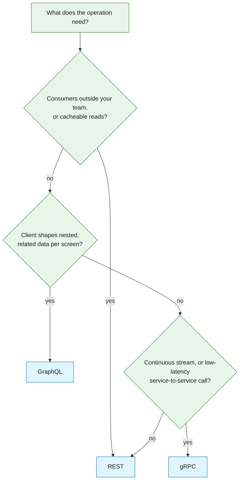
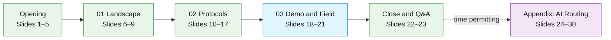
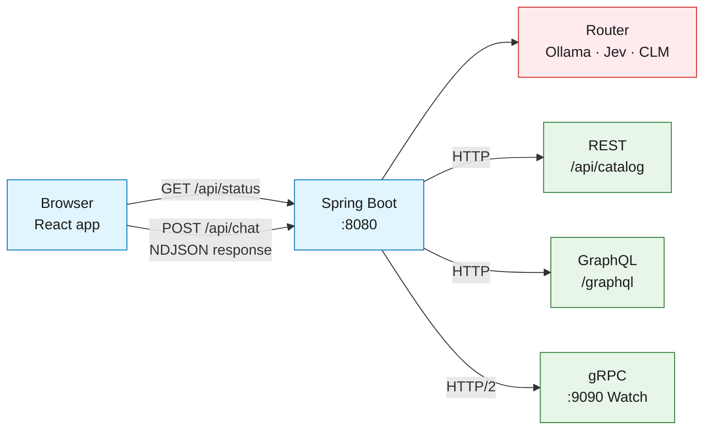
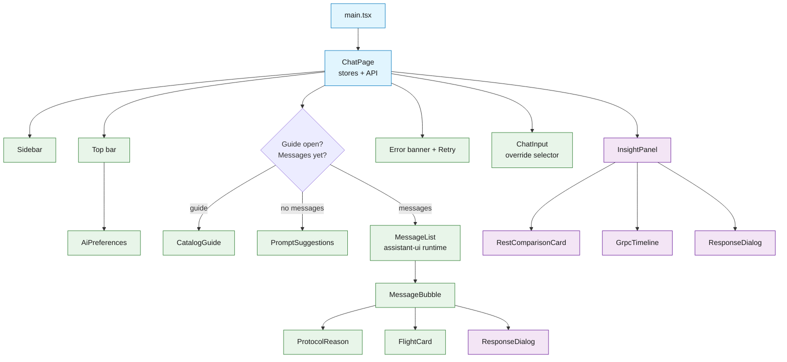
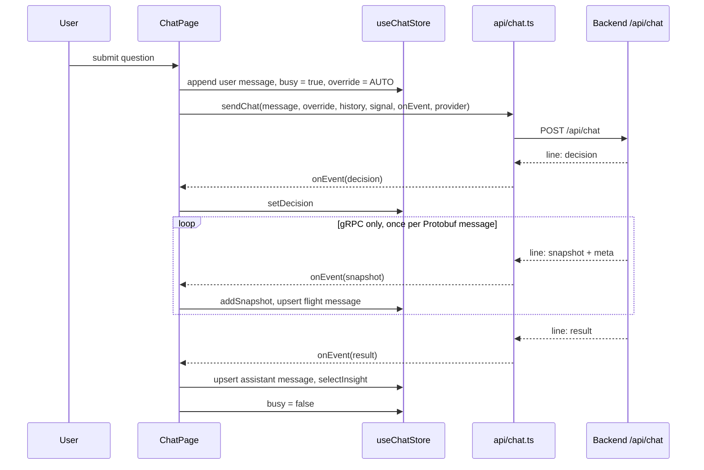
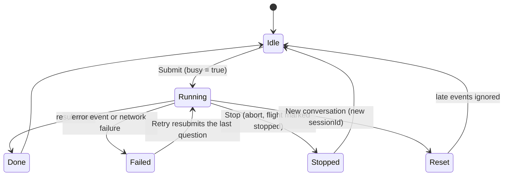
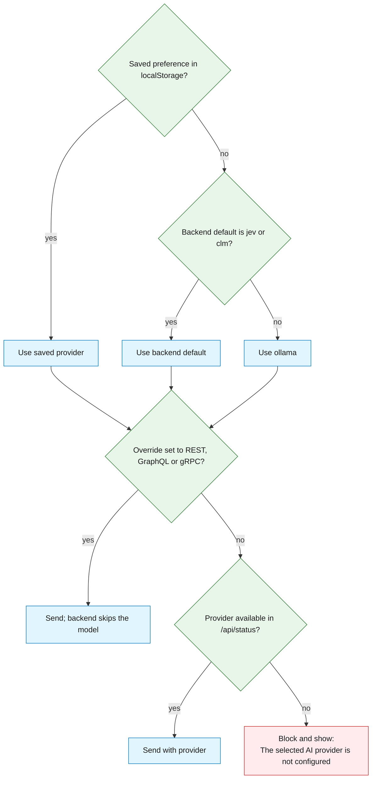

| **Version**      | 0.4              |
| ---------------- | ---------------- |
| **Author**       | Steve Pietrek    |
| **Created**      | 2026-10-08 20:16 |
| **Last Updated** | 2026-10-11 22:56 |

# Protocol Studio Presenter and Frontend Study Guide

Use this guide to practice for the dev2next 2026 session "REST vs GraphQL vs gRPC." It has three parts. Chapter 1 covers the protocol concepts you need to speak about without notes. Chapter 2 goes through the deck (`rest-graphql-grpc-ai-routing-v6.pptx`) one slide at a time, with the speaker notes, the points to land and the questions people are likely to ask. Chapter 3 goes deep on the React frontend, so you can answer anything about what the audience sees on screen.

Most of the audience writes Java. They already know Spring MVC and HTTP well. They will be less familiar with React, browser streaming and how a browser reaches gRPC. Chetan takes backend and Java implementation questions. You own the slides, the demo and the frontend.

> **Callout — Reframe**
> The talk does not crown a winning protocol. It shows how to choose one for each operation. Every answer you give should come back to that idea, especially when someone pushes you to pick a winner.

---

## 1. REST, GraphQL and gRPC: Choosing per Operation

Each of the three protocols fits a different kind of problem. REST is the best fit for addressable, cacheable resources. GraphQL is the best fit when the client needs to decide the shape of nested data. gRPC is the best fit for typed calls between services and for real-time streams. Most production systems run more than one of them on purpose, and Protocol Studio shows this by sending each question to the protocol that suits it.

### 1.1 The Thesis You Are Defending

The session argues for choosing per operation, not per organization. Teams default to the protocol they know. When frontend, backend and integration teams each have a different default, the data contract turns into a negotiation between them. The way out is to look at the shape of each operation (one resource, a graph of related records, or a continuous stream) and pick the protocol designed for that shape.

There are three takeaways, and they are on slide 22. Choose per operation. Design the contract first. Measure the whole path. If you lose your place during Q&A, return to one of these three.

### 1.2 REST: Resources over HTTP

In REST, every resource has a URL, and HTTP verbs carry the intent. Roy Fielding described the style in his 2000 dissertation. REST is easy to adopt because it reuses what HTTP already provides: status codes, content negotiation and caching through browsers, CDNs and proxies. Partners and public consumers can use it with tools they already have, such as curl, Postman, API gateways and OpenAPI.

That simplicity also limits it. A fixed payload returns fields the client did not ask for (over-fetching). Related data can take extra round trips (under-fetching). As client needs diverge, teams create more versions. REST has no built-in streaming, so teams add Server-Sent Events, chunked responses or polling.

| Strength | Strain | What It Means in Practice |
|---|---|---|
| Addressable resources and standard verbs | Over-fetching from fixed payloads | Fine for one-resource lookups, wasteful for screens that need a subset |
| Native HTTP and CDN caching | Under-fetching across related resources | Cheap repeat reads, but extra round trips for joined views |
| The tooling everyone already has | Versioning pressure as clients diverge | Lowest barrier for partners, but endpoint sprawl over time |
| Works natively in every browser | No first-class streaming | Use SSE or polling for live data |

In the demo, REST handles single-resource lookups. `GET /api/catalog/starships/ship:5` returns the Millennium Falcon with `Cache-Control: max-age=300`.

### 1.3 GraphQL: The Client Chooses the Shape

GraphQL puts one typed schema behind one endpoint. The client sends a query that selects exactly the fields a screen needs, including nested relationships, and gets them back in a single round trip. Facebook built it in 2012 for its mobile apps and published the specification in 2015. Introspection means the schema describes itself, which powers IDE autocomplete, documentation and client code generation.

GraphQL moves the work of shaping data to the client, and moves the cost of answering to the server. Every query is usually a POST to one URL, so plain HTTP caching stops working. Resolvers can trigger N+1 load unless they are batched. A public GraphQL API also needs limits on query depth and query cost, or one client can send a query that is very expensive to resolve.

| Strength | Strain | What It Means in Practice |
|---|---|---|
| One SDL schema describes the whole graph | HTTP caching is harder (POST to one URL) | Use persisted queries or a client-side cache |
| Field selection per screen | N+1 resolver load without batching | Plan for DataLoader-style batching from the start |
| Nested data in one round trip | Public APIs need depth and cost limits | Add query limits before exposing it externally |
| Introspection drives tooling and codegen | More server-side complexity to secure | The server team owns more than with REST |

In the demo, GraphQL handles relationship questions. The `FilmShipsCast` query selects a film title, its cast names and its ship names in one request.

### 1.4 gRPC: Typed Contracts and Streaming

gRPC is contract-first RPC over HTTP/2. A `.proto` file defines services and messages. Code generators produce typed clients and servers in many languages, and messages travel as compact binary Protobuf. Google open-sourced it in 2015, released 1.0 in 2016, and it joined the CNCF in 2017. It supports four call types: unary, server streaming, client streaming and bidirectional streaming. Deadlines, cancellation and metadata are built in.

Its main weakness is the browser. Browser JavaScript cannot control HTTP/2 framing and trailers the way a gRPC client must, so browsers need gRPC-Web, Connect or a server-side bridge. Binary payloads are harder to read while debugging. gRPC needs HTTP/2 end to end through every proxy and load balancer. Field numbers in a `.proto` file are permanent: once a field number is used, it can never be given a different meaning.

| Strength | Strain | What It Means in Practice |
|---|---|---|
| Generated clients from one contract | Browsers need gRPC-Web or a bridge | Best for internal paths, not your public edge |
| Compact Protobuf, HTTP/2 multiplexing | Binary payloads are harder to debug | You need tools like grpcurl or an in-app inspector |
| Four call types, including bidirectional | HTTP/2 required end to end | Check that every proxy and load balancer supports it |
| Deadlines and cancellation built in | Field numbers are forever | Retire fields with `reserved` instead of reusing them |

The demo's own contract has an example of field-number discipline. `catalog.proto` marks field 5 and the old name `producers` as `reserved`, because the original dataset's producer data was removed. If someone asks how protobuf schemas evolve, point to that line.

### 1.5 Side-by-Side Comparison

Slide 8 has the comparison table, and you should be able to recite it. It contains two corrections to a common version of this table: GraphQL does stream (through subscriptions), and gRPC does not run natively in a browser.

| Feature | REST | GraphQL | gRPC |
|---|---|---|---|
| Transport | HTTP/1.1, HTTP/2 or HTTP/3 | HTTP, usually one POST endpoint | HTTP/2 (required) |
| Payload | JSON (any media type) | JSON | Protobuf, binary |
| Contract | OpenAPI (optional) | SDL schema (required) | `.proto` file (required) |
| Data shape | Fixed per endpoint | Client selects fields | Fixed per RPC, strongly typed |
| Caching | Native HTTP and CDN caching | Client-side or persisted queries | Application-level |
| Streaming | SSE or chunked responses | Subscriptions | Server, client and bidirectional |
| Browser support | Native | Native | Needs gRPC-Web or a bridge |
| Best fit | Public and resource APIs | Client-driven nested data | Service-to-service, low latency |

### 1.6 A Decision Path You Can Draw on a Whiteboard

When someone asks which protocol they should use, walk through the questions below in order. The diagram follows the same reasoning as slides 7 and 22.

### 1.7 Misconceptions to Correct When They Come Up

Several claims come up in almost every audience. Correct them briefly and politely.

| Claim You May Hear | Correction |
|---|---|
| "GraphQL can't stream." | GraphQL has subscriptions, usually over WebSockets or SSE. |
| "gRPC works in the browser." | Not natively. You need gRPC-Web, Connect or a server-side bridge. The demo uses a bridge. |
| "GraphQL always beats REST on round trips." | Only when the REST design forces extra calls. This demo's REST payload already embeds related records, so both take one request. The difference is field selection. |
| "gRPC is always faster." | Payloads are smaller and connections are multiplexed. Real latency still depends on round trips, payload size and caching across the whole path. |
| "REST is legacy." | REST is still the right default for public, cacheable and partner-facing APIs. |
| "You have to pick one." | Most production systems run more than one protocol on purpose. |

### 1.8 How Protocol Studio Maps Questions to Operations

The router never chooses a protocol directly. It chooses one reviewed operation and an allowlisted target, and each operation has a fixed protocol and, for GraphQL, a fixed selection set. Knowing this table lets you predict what any question will do on stage.

| Operation | Protocol | Answers | Example Question |
|---|---|---|---|
| `STARSHIP` | REST | One starship's speed, length and films | "Tell me about the Millennium Falcon." |
| `FILM` | REST | One film and its cast | "Who is the cast in A New Hope?" |
| `CHARACTER` | REST | One character's record | "Tell me about Luke Skywalker." |
| `SHIPS_IN_FILM` | GraphQL | Ships in a film | "Which starships appear in A New Hope?" |
| `FILM_SHIPS_CAST` | GraphQL | Ships plus the film's character cast | "Which starships appear in A New Hope, and who is in its cast?" |
| `FILM_SHIPS_CREW` | GraphQL | Ships plus who flew them in that film | "Which starships appear in A New Hope, and who flew them?" |
| `SHIP_FILMS` | GraphQL | A ship's films and their cast | "Which films does the Falcon appear in?" |
| `SHIP_CREW` | GraphQL | Documented crew for a ship, optionally by film | "Who flew the Millennium Falcon in A New Hope?" |
| `CHARACTER_FILMS` | GraphQL | A character's films and ships in them | "Which films feature Luke Skywalker?" |
| `COMPARE_STARSHIPS` | GraphQL | Name, speed and length across all ships | "Which starship is fastest?" |
| `TRACK` | gRPC | The simulated flight stream | "Track the Millennium Falcon." |
| `CREW_RECORDS` | REST | Crew records by film (presenter override only) | Never offered to a model |

---

## 2. Slide-by-Slide Presentation Guide

The deck has 30 slides. Slides 1 to 23 are the main talk, and slides 24 to 30 are an appendix on AI routing that you show only if there is time or someone asks. Each slide below has three parts: what is on the slide, the speaker notes from the deck arranged as a script you can practice from, and the questions the audience is most likely to ask about it.

### 2.1 Opening: Slides 1 to 5

The opening has two jobs: tell the audience this is a 300-level session, and tell them there is no winner. Keep the Insight slides short. The audience came for protocols.

#### 2.1.1 Slide 1: Title, "REST vs GraphQL vs gRPC"

The slide shows the title, the subtitle "Choosing the right API protocol for the operation in front of you," a description of the session as an intermediate tour through Protocol Studio, the tagline "Three protocols. One question. The right call." and the three sections: The Protocols, The Demo and The Field.

| Cue | Script |
|---|---|
| Say | "Thank you all for being here. There is a lot on the agenda today, and we do not take your time lightly." |
| Say | "This is a 300-level session on REST, GraphQL and gRPC. Not a beginner overview, and not a vendor pitch." |
| Point 1 | "We will look at where each protocol fits and where it strains." |
| Point 2 | "We will show all three running side by side in one application. Real traffic, nothing mocked." |
| Point 3 | "And we will share what we have seen in the field, with clients who had to make this choice for real." |
| Be clear | "There is no winner in this talk. The goal is to leave you with a way to choose, not a protocol to adopt." |
| Transition | "Let me show you how the session is laid out." |

| Likely Question | Answer |
|---|---|
| "Is the code available?" | Yes. The repository, runbook and measurements are shared at the end. One `docker compose` command runs it. |
| "Do I need an AI API key to run it?" | No. The default router is Ollama running locally. Jev and CLM are optional. |

#### 2.1.2 Slide 2: Introductions

The slide shows photos of both presenters, with titles. Chetan Galgali is Senior Enterprise Architect, and Steve Pietrek is Senior Solutions Principal. The tagline describes "two Insight architects who design and build these integrations with clients every day."

| Cue | Script |
|---|---|
| Say | "Before we get started, a quick introduction." |
| Chetan | "I'm Chetan Galgali, a Senior Enterprise Architect at Insight." |
| Steve | "And I'm Steve Pietrek, a Senior Solutions Principal at Insight." |
| Point | "Between us, we help clients choose and build the integration layer: the APIs, contracts and platforms their systems talk through." |
| Be clear | "Everything we show today comes from real delivery work, and the demo is running code you can try yourself." |
| Transition | "First, a little about Insight." |

Agree on who presents which section before you go on stage. This guide assumes you lead the slides, the demo and frontend questions, and Chetan takes backend and Java questions.

#### 2.1.3 Slide 3: Our Reach as a Solutions Integrator

The slide shows Insight's company facts (Fortune 500, founded 1988, headquartered in Chandler, Arizona), its headline figures (net sales, teammates, certified experts, partners), its two business lines (solutions integration, and technology and supply chain), and a global delivery map.

| Cue | Script |
|---|---|
| Say | "A quick word on who we are. Insight is a Fortune 500 solutions integrator, founded in 1988." |
| Point 1 | "We are about 14,400 teammates worldwide, with more than 6,400 certified consulting and service delivery experts." |
| Point 2 | "We work with more than 6,000 hardware, software and cloud partners, and we delivered $8.2 billion in net sales in 2025." |
| Point 3 | "We deliver directly in North America, Europe and Asia-Pacific, and through partners everywhere else." |
| Be clear | "We are not here to sell. The point is that the patterns in this talk come from many client environments, not one." |
| Transition | "Here is where that expertise sits." |

Spend very little time on this slide. If anyone asks a commercial question, offer to talk after the session.

#### 2.1.4 Slide 4: End-to-End Insight Services for Microsoft Technologies

The slide lists six areas of expertise (Modern Workplace, Intelligent Edge, Data and AI, Cybersecurity, Modern Infrastructure and Modern Apps) and four service lines (Consulting, Change and Training, Software and Lifecycle, and Managed Services).

| Cue | Script |
|---|---|
| Say | "For Microsoft technologies, our work spans six areas of expertise." |
| Point 1 | "Modern workplace, intelligent edge and data and AI." |
| Point 2 | "Cybersecurity, modern infrastructure, and modern applications, which is where the API work in this talk lives." |
| Point 3 | "Each area is backed by four service lines: consulting, change and training, software and lifecycle services, and managed services." |
| Be clear | "Protocol choices like REST, GraphQL and gRPC show up in every one of these areas. That is why they are worth getting right." |
| Transition | "With that, here is what we will cover today." |

| Likely Question | Answer |
|---|---|
| "Is this a Microsoft-only talk?" | No. The protocols are vendor-neutral, and the demo runs on Java, React and open-source models. This slide only describes where Insight does its work. |

#### 2.1.5 Slide 5: Key Expectations and Takeaways (Agenda)

The slide lists four parts: 01 The Landscape (context), 02 The Protocols (two slides per protocol), 03 Demo and Field Stories, and A, an appendix on AI routing, covered if time permits.

| Cue | Script |
|---|---|
| Say | "Here is the shape of the session." |
| Point 1 | "Section one is the landscape: why this choice is still contentious, how the three compare, and the data set we will use throughout." |
| Point 2 | "Section two is the protocols themselves. Each one gets two slides: the concept, then the working code." |
| Point 3 | "Section three is the live demo and two client stories from the field." |
| Point 4 | "There is an appendix on how the demo uses AI to route questions. We will cover it if time allows, or in Q&A." |
| Be clear | "Everything you see today runs. Every request in the demo is real HTTP, GraphQL or gRPC traffic you can inspect." |
| Transition | "Let's start with the landscape." |

### 2.2 Section 01, The Landscape: Slides 6 to 9

This section sets up the problem, compares the three protocols, and introduces the data set. The comparison table on slide 8 is where people most often challenge you, so practice that slide until you can deliver it without notes.

#### 2.2.1 Slide 6: Section Divider, "The Landscape"

The slide lists three items: Defining the Frontier, Key Comparisons and Demo Data Set.

| Cue | Script |
|---|---|
| Say | "Section one: the landscape." |
| Say | "Three short slides here: the problem, the comparison, and the data we will use for every example." |
| Transition | "First, why this is still a debate at all." |

#### 2.2.2 Slide 7: Defining the Frontier for Integration

The slide has three cards. 01, The Problem: every team has a default. 02, The Reality: each protocol has a sweet spot. 03, The Approach: choose per operation. The banner reads "The question is not which protocol wins."

| Cue | Script |
|---|---|
| Say | "The standard for exchanging data between frontends, backends and integrations has always been contentious." |
| Point 1 | "Every team has a default. Frontend teams reach for one thing, backend teams for another, integration teams for a third, and the contract becomes a negotiation." |
| Point 2 | "Each protocol has a sweet spot. Cacheable resources, client-shaped graphs and low-latency streams are genuinely different problems." |
| Point 3 | "So the practical answer is to choose per operation. Most systems we see in production run more than one protocol, deliberately." |
| Be clear | "The question is not which protocol wins. It is which one fits the operation in front of you." |
| Transition | "Let's put them side by side." |

| Likely Question | Answer |
|---|---|
| "Doesn't running several protocols add operational cost?" | Yes, and you should accept that cost only where an operation needs it. The rule from slide 7 still applies: keep each contract typed, versioned and visible. |
| "Who should own the decision?" | Whoever owns the contract for that operation. The decision belongs in API design reviews, not in each team's habits. |

#### 2.2.3 Slide 8: Key Comparisons

The slide has the eight-row comparison table from Section 1.5.

| Cue | Script |
|---|---|
| Say | "Here are the same questions asked of all three." |
| Point 1 | "Transport and payload: REST and GraphQL are HTTP and JSON. gRPC requires HTTP/2 and uses binary Protobuf." |
| Point 2 | "Contract: optional for REST with OpenAPI, required for GraphQL with its schema, and required for gRPC with the proto file." |
| Point 3 | "Caching is where REST is strongest. It gets HTTP and CDN caching for free. GraphQL and gRPC have to work harder." |
| Point 4 | "Streaming and browser support are where gRPC stands out, in both directions: it streams natively, but browsers need gRPC-Web or a bridge." |
| Be clear | "Two corrections from last year's version of this table: GraphQL does stream, through subscriptions, and gRPC does not run natively in a browser. Our demo bridges it, and we will show you how." |
| Transition | "To make this concrete, here is the data every example uses." |

| Likely Question | Answer |
|---|---|
| "Can GraphQL use GET and be cached?" | Yes. Many servers accept GET for queries, and persisted queries give each query a stable ID that a CDN can cache. It takes work that REST gets for free. |
| "What about HTTP/3 for gRPC?" | gRPC is specified on HTTP/2. HTTP/3 support exists in some implementations but is not the baseline you should plan for. |
| "Where do WebSockets fit?" | WebSockets are a transport, not an API contract. GraphQL subscriptions often run over them. Event-driven messaging is a separate decision outside this talk. |
| "What does the demo use to bridge gRPC to the browser?" | The backend calls its own native gRPC service and forwards each Protobuf message to the browser as one line of NDJSON over a normal HTTP response. Chapter 3 covers the browser side. |

#### 2.2.4 Slide 9: One Catalog Behind All Three Protocols

The slide shows 19 starships, 6 films and 18 characters, linked many-to-many. The banner reads: "One immutable, in-memory catalog. REST, GraphQL and gRPC all read the same seeded source."

| Cue | Script |
|---|---|
| Say | "One catalog sits behind all three protocols: nineteen starships, six films and eighteen characters." |
| Say | "The ship values and ship/film links come from the original demo. We added a curated character cast and four verified flight-crew assignments. Cast means characters such as Luke Skywalker and Han Solo." |
| Say | "Ships appear in many films, and characters appear in many films. All three protocols resolve the same immutable seed. There is no database to configure." |
| Be clear | "A character's film appearance does not establish that they piloted a ship. We store the ship, film, character and crew role explicitly. Crew coverage currently includes the Falcon in A New Hope and the Battle of Endor. Missing evidence produces a coverage-gap answer." |
| Transition | "With that in place, let's go protocol by protocol." |
| Background | The historical catalog is shared by all three protocols. A separate, fictional flight script adds changing Falcon telemetry to the Watch stream. Its simulated assignments do not change the sourced film-crew records. |

| Likely Question | Answer |
|---|---|
| "Why no database?" | So the demo needs nothing beyond Docker to run, and so all three protocols are guaranteed to see identical data. Protocol choice is the variable, not storage. |
| "Why Star Wars?" | The data is small, everyone knows it, and it is full of many-to-many relationships, which is exactly where REST and GraphQL differ. |
| "Can it write data?" | No. The demo is read-only on purpose, and mutations are out of scope. |

### 2.3 Section 02, The Protocols: Slides 10 to 17

Each protocol gets two slides: the concept, then the code the demo actually runs. Every "in the demo" slide ends with a "Try it" prompt. Remember those prompts, because you will type them during the demo.

#### 2.3.1 Slide 10: Section Divider, "The Protocols"

| Cue | Script |
|---|---|
| Say | "Section two: the protocols." |
| Say | "Each one gets two slides: the concept first, then the exact code the demo runs. We finish with a short history and a usage comparison." |
| Transition | "We start with the one everyone knows: REST." |

#### 2.3.2 Slide 11: REST, Resources over HTTP

The slide has two lists. "Where REST shines": addressable resources, native caching, universal tooling and the lowest barrier for partners. "Where it strains": over-fetching, under-fetching, versioning pressure and no first-class streaming. The banner reads "Use REST for simple, cacheable, stateless resource APIs."

| Cue | Script |
|---|---|
| Say | "REST is resources over HTTP. Every resource has a URL and the HTTP verbs carry the intent." |
| Point 1 | "Where it shines: standard verbs and status codes, native caching through browsers, CDNs and proxies, and tooling that every developer and every partner already has." |
| Point 2 | "Where it strains: fixed payloads over-fetch, related data means extra round trips, versions multiply as clients diverge, and there is no first-class streaming." |
| Be clear | "REST is still the right default for simple, cacheable, stateless APIs, especially anything you publish to people outside your team." |
| Transition | "Here is what that looks like in the demo." |

| Likely Question | Answer |
|---|---|
| "Does the demo use HATEOAS?" | No. The demo uses plain resource URLs. Hypermedia is part of Fielding's original description but uncommon in practice. |
| "What about sparse fieldsets or JSON:API to fix over-fetching?" | Those approaches work and move REST toward the client-shaped model. Once many screens need custom shapes, you are building part of GraphQL yourself. |

#### 2.3.3 Slide 12: REST in Protocol Studio

The slide shows a request and response: `GET /api/catalog/starships/ship:5`, then `200 OK` with `Cache-Control: max-age=300` and a JSON array holding the Falcon record. Three cards: one route per resource, cacheable by default, picked for simple lookups. Try it: "Tell me about the Millennium Falcon."

| Cue | Script |
|---|---|
| Say | "In Protocol Studio, single-resource lookups go to REST." |
| Point 1 | "Spring MVC exposes starships, films and character cast as resources. The character endpoint is /api/catalog/cast/{id}." |
| Point 2 | "Starship reads return Cache-Control with a five-minute maximum age." |
| Point 3 | "Questions about speed, length or one resource's details route here. Try 'Tell me about Luke Skywalker' for a character lookup." |
| Be clear | "This demo's fixed REST payload already includes nested films, cast and crew. GraphQL lets the client select the needed fields. We should not claim that this REST endpoint always needs more calls. The response excerpt omits nested values for space." |
| Transition | "Next is the query-shaped view of the same catalog." |

| Likely Question | Answer |
|---|---|
| "Why does a single-ship lookup return an array?" | The starships endpoint accepts a target such as `ship:5`, `film:1` or `all` and always returns a list. One shape covers every target. |
| "Where do I see the cache header in the app?" | Open the Request and Response tabs in the Protocol insight panel. The captured exchange shows the headers and body. |

#### 2.3.4 Slide 13: GraphQL, Ask for Exactly What You Need

The slide has two lists. "Where GraphQL shines": one SDL schema, field selection, nested data in one round trip, and introspection. "Where it strains": harder HTTP caching, N+1 resolver load, depth and cost limits, and more server-side complexity. The banner reads "Use GraphQL for client-driven screens that stitch related data: BFFs, mobile apps and micro-frontends."

| Cue | Script |
|---|---|
| Say | "GraphQL is one endpoint and one typed schema, and the client decides the shape of the response." |
| Point 1 | "Where it shines: the schema describes the whole graph, clients ask for exactly the fields a screen needs, and nested relationships come back in one round trip." |
| Point 2 | "Where it strains: HTTP caching is harder because everything is a POST to one URL, resolvers can cause N+1 load without batching, and public APIs need depth and cost limits." |
| Be clear | "GraphQL moves the shaping work to the client, and moves the cost to the server. Plan for resolvers, batching and limits from day one." |
| Transition | "Here is the query the demo sends." |

| Likely Question | Answer |
|---|---|
| "Is GraphQL a good fit for a BFF?" | Yes. A backend-for-frontend is one of its best uses, because each screen selects its own shape from one schema. |
| "How does the frontend consume GraphQL in this demo?" | It doesn't call GraphQL directly. The browser posts a question to `/api/chat`, and the backend sends the GraphQL query. The UI shows the query and response it captured. Section 3.1 explains why. |

#### 2.3.5 Slide 14: GraphQL in Protocol Studio

The slide shows `POST /graphql` with `query FilmShipsCrew($target: String!)`, selecting `films { id title }` and `starships { name crew { filmId role member { name } } }`, with variables `{ "target": "film:1" }`. Three cards: one request with linked records, measured against REST, and crew, not cast. Try it: "Which starships appear in A New Hope, and who flew them?" This is the exact question the GraphQL starter card sends, so clicking the card on stage matches the slide.

| Cue | Script |
|---|---|
| Say | "This is the FilmShipsCrew operation, the one behind the GraphQL starter card. In one query it walks from the film to its ships to each ship's crew, and selects only film ID, title, ship names, roles and member names." |
| Say | "Ask: Which starships appear in A New Hope, and who flew them? The answer lists each ship in the film with its documented crew. The Millennium Falcon shows Han Solo as pilot and Chewbacca as co-pilot. Ships without verified records say so explicitly." |
| Say | "The equivalent REST request is GET /api/catalog/starships/film:1. Its nested records already carry the same data in one request. GraphQL demonstrates field selection, and the inspector measures both response bodies." |
| Be clear | "Crew comes from documented assignments, not from who appears in the film. Cast membership alone does not establish piloting, and crew coverage is partial: A New Hope and the Battle of Endor." |
| Optional | "Which starships appear in A New Hope, and who is in its cast?" routes to the separate `FilmShipsCast` operation, which selects the film's character cast instead of crew. |
| Transition | "Next is the streaming contract." |

| Likely Question | Answer |
|---|---|
| "If REST also takes one request, what does GraphQL buy you here?" | Field selection. The GraphQL response contains only what was asked for, and the SAME DATA OVER REST card shows both body sizes side by side. Size is the honest difference in this data set. |
| "How is the REST comparison measured?" | On the server, by making the equivalent REST call for real and recording its count and body bytes. Nothing is estimated in the browser. |
| "Why does the query select `filmId` on crew?" | A ship's crew list covers every film. The answer keeps only the assignments whose `filmId` matches the requested film, so Endor crew never shows up in an A New Hope answer. |
| "Can I run these queries myself?" | Yes. GraphiQL is enabled on the backend at `http://localhost:8080/graphiql`. Paste the query from the slide, set `target` to `film:1`, and run it. It is served by Spring, not by the React app, so it is not behind the `/api` proxy. |
| "Why do most ships say 'no verified crew records'?" | Crew data is deliberately limited to documented assignments. The app reports the gap rather than guessing from who appears in the film. |

#### 2.3.6 Slide 15: gRPC, Typed Contracts with Streaming by Default

The slide has two lists. "Where gRPC shines": contract-first, Protobuf with HTTP/2 multiplexing, four call types, and deadlines and cancellation. "Where it strains": browsers need a bridge, binary payloads are harder to debug, HTTP/2 is required end to end, and field numbers are forever. The banner reads "Use gRPC for internal service-to-service calls, low-latency paths and real-time streams."

| Cue | Script |
|---|---|
| Say | "gRPC is contract-first RPC over HTTP/2, with compact binary Protobuf messages." |
| Point 1 | "Where it shines: generated clients from one proto file in many languages, HTTP/2 multiplexing, four call types including bidirectional streaming, and deadlines and cancellation built in." |
| Point 2 | "Where it strains: browsers need gRPC-Web or a bridge, binary payloads are harder to debug, you need HTTP/2 end to end through every proxy, and field numbers are forever." |
| Be clear | "gRPC is the right tool for internal service-to-service calls, low-latency paths and real-time streams, not usually for your public API." |
| Transition | "Here is the contract behind the demo's streaming feature." |

| Likely Question | Answer |
|---|---|
| "Why not gRPC-Web in the demo?" | gRPC-Web needs a proxy such as Envoy, and it supports only unary and server streaming. A server-side bridge keeps the demo to one command and lets the backend capture each message for the inspector. |
| "What does 'field numbers are forever' look like?" | Look at `catalog.proto`: field 5 of `TrackedShip` and the name `producers` are `reserved` after that data was removed. Reusing them would break older clients. |

#### 2.3.7 Slide 16: gRPC in Protocol Studio

The slide shows a `catalog.proto` excerpt: `service StarshipTracker { rpc Watch(WatchRequest) returns (stream TrackSnapshot); }` and the `WatchRequest` and `TrackSnapshot` messages. The subtitle reads "one request, 21 updates, about 40 seconds." Three cards: subscribe once, inspectable updates, and bounded and honest. Try it: "Track the Millennium Falcon."

| Cue | Script |
|---|---|
| Say | "Ask once, and the ship's location, pilot and shields change in the chat as updates arrive." |
| Say | "Watch is a real server-streaming gRPC call: one request and twenty-one responses over about forty seconds. The server owns the timeline, so the agent does not rerun the question or ask the model to route every update." |
| Say | "The browser receives each update through the NDJSON bridge. The backend explicitly flushes the servlet response after every event so updates arrive individually." |
| Demonstrate | Click **Present flight**. The Falcon departs Tatooine, Chewbacca takes the controls, a debris alert lowers shields, Han retakes the controls, and the ship travels through hyperspace to Yavin 4. The UI keeps the final state and flight log. Stop keeps the last received state, and Replay starts again. |
| Be clear | This is authored fiction for a repeatable presentation, not canon flight history or live telemetry. The script is separate from documented film-crew records. Only the Falcon has a flight scenario. Other targets return catalog data with an explicit coverage message. Each subscription starts its own timeline. |
| Background | The older bidirectional `Track` method remains for comparison. Bidirectional streaming is useful when a client must change its request during an open stream, and this guided flight only needs server streaming. The proto on the slide is an excerpt. |
| Background | Default pacing is 2000 ms for 40 seconds. `DEMO_FLIGHT_INTERVAL_MS=3000` gives 60 seconds, and 5000 gives 100 seconds. Restart the backend after changing it. The gRPC deadline is 115 seconds. Response sizes count serialized Protobuf bytes, not headers or framing. Playback time is not a protocol speed benchmark. |
| Inspect | Open **gRPC MESSAGES**. Each row shows one message's sequence, serialized Protobuf bytes and arrival time. Expand a row to see its decoded payload. Missing optional metadata cannot shift later rows. Only the first flight message includes the catalog ship record, and later messages carry only the changing flight state. |

| Likely Question | Answer |
|---|---|
| "Why don't I see the gRPC calls in Chrome DevTools?" | The browser never speaks gRPC. DevTools shows one `POST /api/chat` with a streaming response. The gRPC MESSAGES timeline is the in-app view. Outside the app, `grpcurl` against port 9090 streams the same messages, because server reflection is on. |
| "Why are later messages smaller than the first?" | The first message carries the full catalog ship record. Later messages carry only the flight state that changed. The byte column in the timeline shows the drop. |
| "What happens when I click Stop?" | The browser aborts the fetch. The flight card keeps the last update it received and shows it as stopped. The backend notices the closed connection on its next write and cancels the gRPC call. |
| "Is the 40 seconds the protocol's speed?" | No. The server waits between updates on purpose so that people can watch the flight. It is pacing, not latency. |

#### 2.3.8 Slide 17: Where Each Protocol Came From, and Where It Fits

The slide shows a timeline (2000 REST, 2012 GraphQL at Facebook, 2015 GraphQL spec and gRPC open-sourced, 2016 gRPC 1.0 and CNCF in 2017) and a table comparing learning curve, ecosystem and typical use cases.

| Cue | Script |
|---|---|
| Say | "Each of these answered the problem of its moment." |
| Point 1 | "REST was described in Roy Fielding's dissertation in 2000." |
| Point 2 | "GraphQL was built inside Facebook in 2012 for mobile, and published as a spec in 2015." |
| Point 3 | "gRPC was open-sourced by Google in 2015, reached 1.0 in 2016, and joined the CNCF in 2017." |
| Say | "On the practical side: REST has the lowest learning curve and the largest ecosystem. GraphQL and gRPC are both mature, and gRPC's learning curve is mostly the toolchain rather than the concepts." |
| Transition | "Enough slides. Let's look at it running." |

| Usage Row | REST | GraphQL | gRPC |
|---|---|---|---|
| Learning curve | Low | Medium | Medium: Protobuf and toolchain |
| Ecosystem | Abundant | Mature and growing | Mature in cloud-native |
| Typical use cases | Public APIs, identity, legacy integration | Mobile, BFFs, micro-frontends, multi-tenant | Microservices, IoT, real-time streams |

### 2.4 Section 03, Demo and Field Stories: Slides 18 to 21

The live demo is the riskiest part of the session, and it is also what the audience will remember. Warm up the local model beforehand, and use the starter cards: their questions now match the deck exactly. Know where every number in the insight panel comes from (Section 3.7).

#### 2.4.1 Slide 18: Section Divider, "Demo and Field Stories"

| Cue | Script |
|---|---|
| Say | "Section three: the demo, and then two stories from the field." |
| Transition | "Let me switch over to Protocol Studio." |

#### 2.4.2 Slide 19: Demo, "Let's Get Into the Code"

The slide has three demo cards (REST simple lookup, GraphQL relationships and gRPC streaming), the run command `docker compose up --build -d` then `open http://localhost:3000`, and the "Built with" stack: React 19, TypeScript, assistant-ui, Zustand and Tailwind v4 on the frontend; Java 25, Spring Boot 4.1, Spring for GraphQL and Spring for gRPC on the backend; Ollama locally and Jev as an optional hosted router. The three card questions match the three starter cards in the app, so you can click instead of type.

| Cue | Script |
|---|---|
| Say | "This is Protocol Studio. Ask a question, see the selected protocol and its explanation, and inspect the real request and response." |
| Do 1 | Ask "Tell me about the Millennium Falcon." Show REST, the cache header and the response size. |
| Do 2 | Click the GraphQL starter card, "Which starships appear in A New Hope, and who flew them?" Show `query FilmShipsCrew`, target `film:1`, and the answer: the Falcon with Han Solo (pilot) and Chewbacca (co-pilot), and other ships marked as having no verified crew records. Compare one GraphQL request with one REST request. Explain that the REST body includes nested records while GraphQL selects the requested fields. |
| Do 3 | Ask "Track the Millennium Falcon." Click Present flight and watch location, pilot, shields and flight events update over about forty seconds. Point out the Chewbacca handoff, alert, recovery and arrival. Close the presentation view and inspect one Watch request with twenty-one responses. |
| Optional | "Where is the Millennium Falcon currently?" and "Who is currently flying the Millennium Falcon?" also start the labeled simulation. Each new request starts its own replay, not a shared, continuously running galaxy. |
| Optional | "Which starships appear in A New Hope, and who is in its cast?" shows the separate `FilmShipsCast` operation with the film's characters. "Which films feature Luke Skywalker?" explores character appearances. "Who flew the Millennium Falcon in Return of the Jedi?" returns Lando Calrissian and Nien Nunb for the Battle of Endor. |
| Crew follow-up | Ask "Who flew the Millennium Falcon in A New Hope?" Show `query ShipCrew` and target `crew:5:1`. The REST comparison fetches `/api/catalog/starships/crew:5:1`. The answer names Han Solo and Chewbacca. |
| Stream follow-up | Expand a gRPC MESSAGES row and point out the sequence, byte count, arrival time and decoded payload. Each row matches its snapshot by sequence. |
| Be clear | "Cast means fictional characters. Flight-crew data is film-specific and partial. The gRPC flight is a clearly labeled fictional simulation, separate from documented film crew. It is repeatable, not a canon itinerary or live telemetry." |
| Be clear | "A presenter override applies to one question and the UI labels it. Allow the local model to warm up before presenting." |
| Transition | "That is the lab example. Here is what this looks like with real clients." |

The run sheet below lists each demo step, what the screen should show, and what to point at.

| Step | What You Do | Expected Protocol and Operation | What to Point At |
|---|---|---|---|
| 1 | Click the REST card, or type "Tell me about the Millennium Falcon." | REST, `STARSHIP`, `ship:5` | REST badge, "Why this protocol," `GET /api/catalog/starships/ship:5`, response body bytes, cache header in Response tab |
| 2 | Click the GraphQL card, "Which starships appear in A New Hope, and who flew them?" | GraphQL, `FILM_SHIPS_CREW`, `film:1` | `query FilmShipsCrew`, Falcon crew in the answer, SAME DATA OVER REST card, byte comparison |
| 3 | Click the gRPC card, "Track the Millennium Falcon." | gRPC, `TRACK`, `ship:5` | Flight card updating in the chat, Present flight, gRPC MESSAGES timeline filling live |
| 4 | Close presentation view, open the finished insight | gRPC | One Watch request, twenty-one rows, expand one row, total bytes |
| Fallback | Model slow or wrong | Use the override selector | PRESENTER SELECTED label, explain the override resets after one question |

The starter cards appear only before the first message. If you have already asked something, type the questions instead, or click New conversation to bring the cards back.

| Likely Question | Answer |
|---|---|
| "What if the model routes wrong live?" | You see the mistake in the insight panel. The system never hides a mistake with a silent fallback. Use the Force selector for the next question and point out the PRESENTER SELECTED label. |
| "Why is the first question slow?" | A cold local model has to load into memory first. Warm it up before going on stage. |
| "Is the answer text generated by the model?" | No. The model only chooses the route. The backend builds the answer text from the actual protocol response, so it cannot invent facts. |
| "Can I run this on my laptop?" | Yes. Run `docker compose up --build -d` and open `localhost:3000`. No API keys are needed. |

#### 2.4.3 Slide 20: Client Story, Port Terminal Operator

The slide describes a leading U.S. marine terminal operator. The approach covered UX workshops, Figma wireframes, Next.js on Vercel, and Strapi Cloud as a headless CMS. Protocols in play: REST and GraphQL. Results: new pages in hours instead of days, smaller image payloads and better organic search traffic.

| Cue | Script |
|---|---|
| Say | "Our first client story is a leading U.S. marine terminal operator. They needed a corporate website that was fast, modern, and that marketing could run on its own." |
| Point 1 | "We started with interactive UX workshops to map user journeys and critical paths, and refined wireframes in Figma alongside stakeholders." |
| Point 2 | "The site runs on Next.js on Vercel, with Strapi Cloud as a headless CMS. Pages pull content through Strapi's REST and GraphQL APIs." |
| Point 3 | "Reusable Strapi components let marketing build new pages without IT." |
| Be clear | "The payoff is operational: new pages in hours instead of days, 45% smaller image payloads, zero-downtime deployments, and better organic search traffic." |
| Transition | "The second story made a very different choice." |

> **Callout — Phase Gate**
> The deck's notes say to check the image-payload reduction and the organic-traffic improvement with the delivery team or the client before showing this slide outside an RFP context. Never name the client.

| Likely Question | Answer |
|---|---|
| "Which pages used REST and which used GraphQL?" | Stay at the level on the slide: the choice was made page by page. Pages that needed nested content used GraphQL, and simple content reads used REST. Do not add delivery details that aren't confirmed. |
| "Who is the client?" | We don't name the client. |

#### 2.4.4 Slide 21: Client Story, Global Retail Coffee Manufacturer

The slide describes a next-generation point-of-sale and ordering system: 33k locations, where security and offline operation matter most. "Why gRPC": better experiences for barista and customer, limited ability to expose endpoints at the store, reduced exposure and better performance, and typed gRPC contracts. Where it is going: the drive-thru.

| Cue | Script |
|---|---|
| Say | "Our second client is a global retail coffee company, rebuilding point of sale and ordering." |
| Point 1 | "Thirty-three thousand locations. Security and offline operation are non-negotiable." |
| Point 2 | "They have limited ability to expose endpoints at the store." |
| Point 3 | "gRPC integration reduced that exposure and increased performance, with typed contracts between services." |
| Be clear | "Same decision process, different answer. The constraints (exposure, offline, performance) pointed to gRPC." |
| Transition | "So what should you take away from all of this?" |

| Likely Question | Answer |
|---|---|
| "How does gRPC reduce exposure?" | It replaces a broad set of inbound HTTP endpoints at the store with a small number of typed service contracts. Leave the specifics to Chetan or offer to follow up. |
| "How does offline work with gRPC?" | That is an architecture question beyond the slide. Say that offline operation was a design constraint and offer to follow up rather than guess. |

### 2.5 Close: Slides 22 and 23

The close repeats the three takeaways and asks for questions. Before presenting, replace the "[repository link]" placeholder on slide 22.

#### 2.5.1 Slide 22: Three Things to Take Away

The slide has three cards (choose per operation, design the contract first, measure the whole path), the quote "Three protocols. One question. The right call, made where you can see it.", and a repository link placeholder.

| Cue | Script |
|---|---|
| Say | "Three things to take away." |
| Point 1 | "Choose per operation. REST for cacheable resources, GraphQL for related data, gRPC for streams and service-to-service calls. Most systems use more than one." |
| Point 2 | "Design the contract first. OpenAPI, schema or proto file: the contract outlives the implementation and drives your tooling, tests and code generation." |
| Point 3 | "Measure the whole path. Round trips, payload size and caching decide real-world latency more than the protocol label does." |
| Be clear | "Everything you saw today is in the repository (the code, the runbook and the measurements) so you can run it yourself." |
| Transition | "With that, let's open it up." |

#### 2.5.2 Slide 23: Thank You and Questions

The slide shows "/questions," both presenters, and "Try it yourself" in three steps: Run, Ask, Inspect.

| Cue | Script |
|---|---|
| Say | "Thank you. We would love to take your questions." |
| Say | "If you want to try it yourself, it is one command: docker compose up, then open localhost:3000. No API keys needed." |
| If asked about AI | "The appendix covers how the demo lets a local model or Jev choose the protocol. I am happy to walk through it." |

Before the first question, agree out loud on who answers what: "Chetan will take the Java and backend questions, and I'll take the demo and frontend." The audience then knows where to direct each question.

### 2.6 Appendix, AI Routing: Slides 24 to 30

Use the appendix only if you have time or someone asks about AI. These slides describe the backend, so for implementation detail, give the headline and hand off to Chetan.

#### 2.6.1 Slide 24: Appendix Divider, "AI Routing"

The slide lists four items: Architecture, Ollama, Jev, and Trade-offs and guardrails. The appendix no longer has a timings slide.

| Cue | Script |
|---|---|
| Say | "This appendix explains how Protocol Studio lets a model choose the protocol, without letting it invent the answer." |
| Point 1 | "The architecture: how a question becomes a protocol call." |
| Point 2 | "Two ways to make the decision: Ollama tool calling on a small local model, and Jev's structured decisions." |
| Point 3 | "The trade-offs between the two, and the guardrails that keep it honest." |
| Transition | "Here is the path a question takes." |

#### 2.6.2 Slide 25: How Protocol Studio Routes a Question

The slide shows five steps (Ask, Classify, Decide, Execute, Answer) and the banner "The model chooses the route. It never supplies the data."

| Cue | Script |
|---|---|
| Say | "Every question goes through five steps." |
| Point 1 | "The browser posts the message and recent turns." |
| Point 2 | "A classifier (Ollama or Jev, behind one interface) picks one protocol and one allowlisted target." |
| Point 3 | "The decision is just protocol plus target. Never a URL, never query text." |
| Point 4 | "The server calls its own REST, GraphQL or native gRPC endpoint. Real traffic." |
| Point 5 | "The answer is composed from the response, and the inspector shows the payloads and timings." |
| Be clear | "The model chooses the route. It never supplies the data. If it routes wrongly, you can see it, and it cannot invent facts." |
| Transition | "Let's look at the default router: Ollama." |

Step 1 is the frontend's part of this flow. Section 3.5 shows exactly what the browser sends and how it reads the four event types that come back.

#### 2.6.3 Slide 26: Local Routing with Ollama Tool Calling

The slide shows a JSON tool definition for `FILM_SHIPS_CAST` with an enum-bound `target`, and four cards: the tool chooses the operation, targets are bound to an enum, a pinned small model (`qwen3:4b-instruct-2507`, q4_K_M, no thinking mode), and latency tuning (temperature 0, 96-token cap, 30-minute keep-alive, startup warm-up).

| Cue | Script |
|---|---|
| Say | "The default is genuine tool calling on a small local model. No API key, and no cloud dependency." |
| Point 1 | "There is one tool per reviewed operation. The model selects an operation and catalog target. Each operation fixes its protocol and GraphQL selection set." |
| Point 2 | "The target is an enum, so the model can only pick catalog IDs that exist." |
| Point 3 | "We pin a four-billion-parameter instruct model without thinking mode, running locally." |
| Point 4 | "It is tuned for latency: temperature zero, a 96-token cap, a thirty-minute keep-alive and a warm-up at startup." |
| Be clear | "Pin the exact model tag. The unqualified tag resolves to a thinking model that burns tokens before it calls a tool." |
| Transition | "The alternative is a model built for decisions rather than text." |
| Background | Character target `cast:1` is Luke Skywalker. Crew target `crew:5:1` keeps both the Falcon and A New Hope. The backend rejects unsupported target formats. Missing crew evidence remains a valid coverage-gap result. |

#### 2.6.4 Slide 27: Jev, a Decision Model, Not a Text Generator

The slide shows a `POST /v1/systemone` request with two `choice` questions (operation and target), and three cards: answers instead of prose, the same contract as Ollama, and hosting by TypeSafe.

| Cue | Script |
|---|---|
| Say | "Jev is a decision model, not a text generator." |
| Point 1 | "Instead of generating text, we ask two typed choice questions: which operation, and which target." |
| Point 2 | "Each answer comes back with a confidence and probabilities, and we show them in the inspector." |
| Point 3 | "It plugs in behind the same interface. One environment variable switches providers." |
| Point 4 | "It is hosted by TypeSafe, so it needs internet access and an API key. The key never leaves the server." |
| Be clear | "Jev is optional. For a small, closed decision like this one, a structured decision fits better than free-form generation." |
| Transition | "So how do you choose between them?" |

Show the confidence in the app by opening the **Decision** tab in the insight panel after a Jev-routed question. With Ollama, the same tab shows the raw tool call and no confidence.

#### 2.6.5 Slide 28: Ollama vs Jev

The slide compares the two routers across mechanism, where each runs, output, confidence, setup and best fit. The banner reads "Presenter overrides bypass the model entirely for one question, and the UI says so."

| Cue | Script |
|---|---|
| Say | "Both routers make the same decision in different ways." |
| Point 1 | "Ollama runs locally and works offline, which matters for demos and data residency. It does not report confidence, and we do not invent one." |
| Point 2 | "Jev is hosted, needs a key, and gives you calibrated confidence per decision." |
| Be clear | "Presenter overrides bypass the model for one question, and the UI says so every time." |
| Transition | "So what does each one give you, and what does it cost you?" |

| Likely Question | Answer |
|---|---|
| "The app also shows CLM. What is that?" | A third provider that uses the same typed-decision contract as Jev but runs on a server you host yourself. It is off until the backend has a CLM URL. The deck covers only the two main routers. |
| "Can different users pick different routers?" | Yes. Each browser saves its own choice and sends it with every request. There is no server-wide setting that one user can change for everyone. |

#### 2.6.6 Slide 29: Ollama vs Jev, Pros and Cons

Slide 29 is new and replaces the old timings slide. It has a two-row table, Pros and Cons, with a column for each router, and a banner: "Pick by constraint. Offline demos and data residency point to Ollama. Calibrated confidence points to Jev. Either way, a failure shows an error, never a silent fallback."

| | Ollama (default) | Jev (optional) |
|---|---|---|
| Pros | No API key, no cloud dependency, works offline. Questions never leave the machine. Genuine tool calling with enum-bound targets. A pinned model gives repeatable routing. | Built for closed decisions: typed choices, not free text. Confidence and probabilities on every decision. No model download or local GPU needed. Same interface: one environment variable to switch. |
| Cons | Multi-gigabyte model download, and a slow first question while it loads. Routing speed depends on local hardware. No confidence score to judge a close call. A small model can misroute an ambiguous question. | Needs internet access and an API key. The question and recent turns go to a hosted third-party service. Latency and availability depend on that service. No offline mode for demos or restricted networks. |

| Cue | Script |
|---|---|
| Say | "Here is what you gain and what you give up with each." |
| Point 1 | "Ollama: no key, no cloud, it works offline, and the question never leaves the machine. The cost is a multi-gigabyte model, a slow first question while it loads, speed that depends on your hardware, and no confidence score." |
| Point 2 | "Jev: built for closed decisions, with confidence and probabilities on every choice, and nothing to download. The cost is an internet dependency, an API key, and sending the question and recent turns to a hosted service." |
| Be clear | "Pick by constraint. Data residency and offline operation point to Ollama. Calibrated confidence points to Jev. Either way, if the router fails you see an error, not a silent fallback." |
| Transition | "That brings us to the rules that keep this honest." |

| Likely Question | Answer |
|---|---|
| "How fast is routing?" | The insight panel shows it on every answer as ROUTING TIME, next to PROTOCOL TIME and TOTAL SERVER TIME. Routing dominates; the protocol call itself is small. Point at the panel instead of quoting a figure, because it depends on hardware and on whether the model is warm. |
| "Which would you use in production?" | It depends on the constraint on the slide. Regulated or offline environments lean toward a local model. Teams that need a confidence threshold to decide when to ask a human lean toward a decision model like Jev. |
| "Does the app see my question when I use Jev?" | The browser sends it to our backend, and only the backend calls Jev. The AI preferences dialog says plainly that the question and recent conversation go to TypeSafe. |

#### 2.6.7 Slide 30: Five Rules That Keep the Router Honest

The slide lists five rules: allowlisted targets, no hidden fallback, labeled overrides, grounded answers, and secrets kept server-side. It is now the last slide of the appendix.

| Cue | Script |
|---|---|
| Say | "Five rules make it safe to put a model in the request path." |
| Point 1 | "Allowlisted targets: the model picks from catalog IDs, never URLs or queries." |
| Point 2 | "No hidden fallback: if the model fails, you see an error, not keyword routing labeled as AI." |
| Point 3 | "Labeled overrides: they apply to one question, then routing resets to Auto." |
| Point 4 | "Grounded answers: every answer is built from the actual transport response." |
| Point 5 | "Secrets stay server-side, and ports bind to loopback by default." |
| Transition | "That is the appendix. Happy to take questions on any of it." |

Three of the five rules are enforced in the frontend, and you can point to the code. When a failure happens, the error banner with Retry appears (no hidden fallback). After every send, the override resets to Auto (labeled overrides). The browser never receives a key; it sees only `available: true` or `false` (secrets stay server-side).

### 2.7 Recent Deck and Code Changes

The deck now follows the code, which is the source of truth. CLM stays in the app and out of the deck by design. The deck file keeps the v6 name. The table records what changed from the previous version, so you can spot the differences while rehearsing.

| Change | Slides | What It Fixes |
|---|---|---|
| GraphQL example switched from `FilmShipsCast` to `FilmShipsCrew`, with the question "…and who flew them?" | 14, 19 | The slide now matches the GraphQL starter card, so clicking the card shows the query on the slide |
| Timings slide removed | Old 30 | Its numbers came from an earlier catalog and could not be reproduced on the current demo |
| Ollama vs Jev pros and cons added | New 29 | Gives the appendix a trade-off discussion instead of fixed timings |
| Guardrails renumbered and made the closing appendix slide | 30 | New transition ends the appendix |
| Agenda and appendix divider wording | 5, 24 | "Latency" replaced with "trade-offs" |
| Repository link | 22 | Placeholder replaced with the real link |
| GraphiQL enabled on the backend (Chetan) | None | Anyone can run the demo's GraphQL queries by hand at `http://localhost:8080/graphiql` |

One related code change shipped alongside the deck update. The "Force gRPC · next question" option in `ChatInput.tsx` now reads "Stream live starship updates over one subscription." It used to say "Stream three catalog snapshots," which no longer described what forcing gRPC on the Falcon does.

---

## 3. Frontend Code Deep Dive

The frontend is a single-page React application with one job: send a plain-language question to the backend, then show, as events arrive, the routing decision, any gRPC updates and the final answer. The browser never talks to Ollama, Jev or CLM, never sees an API key, and never speaks GraphQL or gRPC itself. It uses two backend endpoints: `GET /api/status` and `POST /api/chat`.

### 3.1 Why the Browser Only Talks to Two Endpoints

The backend runs every protocol call. The browser only displays what happened. This choice answers the most common frontend question from the audience: "Why doesn't the React app call GraphQL or gRPC directly?" There are three reasons. A browser cannot speak native gRPC without gRPC-Web and a proxy. The server can measure real REST comparisons and capture Protobuf messages, which the browser cannot. Keeping the router server-side keeps model keys out of the browser.

The consequence is that every protocol reaches the UI the same way, as a stream of typed JSON events. The UI does not need a separate client library for each protocol.

### 3.2 Technology Stack

The stack is current React tooling. For a Java audience, Vite is roughly what Maven and a dev server are together, Zustand plays the role of a singleton state bean, and Vitest plays the role of JUnit.

| Technology | Version | Role | Closest Java Analogy |
|---|---|---|---|
| React | 19 | UI components, rendered in `StrictMode` | Server-side templates, but the UI is rebuilt in the browser whenever state changes |
| TypeScript | 6 | Typed components, API payloads and stores | Java's static typing for JavaScript |
| Vite | 8 | Dev server on 5173, production build, `/api` proxy to 8080 | Build tool plus dev server |
| Zustand | 5 | Two stores: chat (memory only) and preferences (persisted) | A singleton bean that holds state and notifies subscribers when it changes |
| assistant-ui | 0.15 | Chat thread primitives: auto-scrolling viewport, running state | A UI component library for chat |
| Tailwind CSS | 4 | Utility classes, alongside hand-written CSS in `index.css` | None; a styling approach |
| Radix UI | 1.x and 2.x | Accessible Dialog, Select and Slot primitives | Unstyled, accessible Swing-like widgets |
| class-variance-authority, clsx, tailwind-merge | latest | shadcn/ui button variants and class merging | None |
| lucide-react | 1.x | Icons | None |
| Vitest, Testing Library, jsdom | 5, 16, 30 | Component, page, store and API tests | JUnit plus a simulated browser |
| ESLint, Prettier | 10, 3 | Linting with an import-boundary rule, and formatting | Checkstyle or ArchUnit, plus Spotless |
| nginx (unprivileged) | 1.28 | Serves the built app in Docker and proxies `/api/` | The web tier in front of the app server |

### 3.3 Project Layout and Ownership Rules

The codebase has one rule that decides most of its structure: only pages may touch stores or the API client. Components receive props and send events back through callbacks. ESLint enforces this, so breaking the rule fails the build.

| Path | Responsibility |
|---|---|
| `src/main.tsx` | Entry point. Renders `ChatPage` inside `React.StrictMode`. |
| `src/pages/ChatPage.tsx` | The only page, and the only module that uses stores and API clients. Owns submit, cancel, reset, retry and layout. |
| `src/api/chat.ts` | `getStatus()` and `sendChat()`. Parses the NDJSON stream into typed events. |
| `src/store/useChatStore.ts` | Conversation, protocol and session state in three slices. Never persisted. |
| `src/store/usePreferencesStore.ts` | The selected AI provider, persisted in `localStorage` under `protocol-studio-preferences`. |
| `src/types.ts` | Types that mirror the backend records: `Decision`, `Exchange`, `RestComparison`, `Insight`, `TrackSnapshot`, `FlightState`, `ChatEvent`. |
| `src/components/Sidebar.tsx` | Workspace navigation, protocol legend, router card, field guide link. |
| `src/components/AiPreferences.tsx` | Provider picker dialog in the top bar. |
| `src/components/InsightPanel.tsx` | The Protocol insight panel: route diagram, metrics, REST comparison, gRPC timeline, payload tabs. |
| `src/components/ResponseDialog.tsx` | Full-screen view of a captured response, with copy. |
| `src/components/ProtocolBadge.tsx`, `ProtocolReason.tsx` | Protocol pill and the "Why this protocol" callout. |
| `src/components/CatalogGuide.tsx` | The dataset and demo field guide view. |
| `src/components/chat/MessageList.tsx` | The chat thread on assistant-ui's external store runtime. |
| `src/components/chat/ChatInput.tsx` | Text input, send and stop, and the next-question override selector. |
| `src/components/chat/PromptSuggestions.tsx` | Three starter cards shown before the first question. |
| `src/components/chat/FlightCard.tsx` | Live view of the simulated Falcon flight. |
| `src/components/ui/` | shadcn-style `button`, `dialog` and `select`. |
| `src/lib/protocols.ts`, `src/lib/utils.ts` | Protocol display labels and the `cn()` class-name helper. |
| `src/index.css` | Tailwind import and all component styles. |
| `src/test/` | Test setup and shared fixtures. |

The ownership rules below hold the design together. Expect questions about them from architects in the room.

| Rule | Enforced By | Why |
|---|---|---|
| Only pages import stores or API clients | ESLint `no-restricted-imports` on `src/components/**` and `src/lib/**` | Components stay presentational and are easy to test and reuse |
| Stores never import API clients | ESLint rule on `src/store/**` | State holds data and the page orchestrates network calls |
| Conversation history is never persisted | `useChatStore` has no persistence | Refresh or New conversation clears everything, and no chat data stays in the browser |
| Only the provider choice is persisted | `usePreferencesStore` `partialize` and `merge` | Preference survives reloads, and invalid saved values are discarded |
| Stale responses cannot modify a new conversation | `sessionId` check in `ChatPage` | Late events from a cancelled or reset request are dropped |
| An override applies to one question | `ChatPage.submit` resets the override to `AUTO` | A presenter cannot leave a forced protocol on by accident |
| Failures never fall back silently | Error banner with Retry | The user always knows when routing failed |
| Coverage of 80% or higher | Vitest thresholds on lines, statements, functions, branches | Changes ship with tests |

### 3.4 Component Tree

`ChatPage` sits at the root and owns all state. Everything below it receives props. Where it picks its view: the field guide replaces the chat when open, starter cards show before the first message, and the message list shows after it.

### 3.5 The API Client and the NDJSON Stream

`sendChat()` is the most important function in the frontend. It posts the question, then reads the response body as a stream, one line at a time. Each complete line is a JSON event, and the function passes each event to the page through an `onEvent` callback as soon as it arrives.

The request body contains four fields. `message` is the question. `provider` is `ollama`, `jev` or `clm`. `override` is `null` for automatic routing, or `REST`, `GRAPHQL` or `GRPC`. `history` holds up to the last 20 messages, each cut to 4,000 characters. The text box itself caps input at 2,000 characters.

| Event | Payload | What the Page Does |
|---|---|---|
| `decision` | `Decision`: protocol, operation, target, source, reason, classification | Stores it so the insight panel highlights the protocol while the call is still running |
| `snapshot` | `TrackSnapshot`, plus optional `meta` with sequence, bytes and elapsed time | Adds it to the live lists. Flight snapshots create or update one streaming `FlightCard` message |
| `result` | `answer` text and the full `Insight` | Writes the final assistant message and selects its insight in the panel |
| `error` | `message` | `sendChat` throws, and the page shows the error banner with Retry |

The parser has three details people ask about. It keeps a text buffer, because a network chunk can end halfway through a line, so the last partial line waits for the next chunk. If the stream ends without a `result`, that counts as an error ("Connection ended before the answer arrived"). The `finally` block always cancels and releases the reader, so an abandoned stream does not leak.

**Why NDJSON and not SSE or WebSockets?** The browser's `EventSource` API only supports GET, and the chat request needs a JSON body. `fetch` with a streaming body reader supports POST and works with `AbortController` for Stop. Each line is a complete, standalone JSON document, so parsing is a split on newlines. WebSockets would add a second protocol and connection lifecycle for what is a one-way stream from server to browser.

**What has to be true for the stream to arrive in pieces?** Every hop must pass bytes through without buffering. The backend flushes after each event. In development, Vite's proxy passes the stream through. In Docker, nginx sets `proxy_buffering off` for `/api/`. If a proxy buffers, the whole answer arrives at once at the end.

### 3.6 ChatPage Orchestration: Submit, Stop, Reset and Retry

`ChatPage` controls the whole request lifecycle. It reads status once when it mounts. It works out which provider to use, sends questions, ignores events that arrive too late, and handles Stop, New conversation and Retry.

**On mount**, `getStatus()` runs once with its own `AbortController`. The status lists each provider with its model, whether it is local, and whether it is configured. The top bar shows "Backend connected" or "Backend unavailable." Status is not polled, so after the backend configuration changes, refresh the page.

**On submit**, the page runs these steps in order. It ignores the submit if the text is empty or a request is already running. If the override is `AUTO` and the selected provider is unavailable, it shows "The selected AI provider is not configured" and stops. Otherwise it creates a new `AbortController`, records the current `sessionId`, appends the user message, sets `busy` (which clears the previous snapshots, wire metadata and error), clears the decision and the selected insight, saves the override value, resets the selector to `AUTO`, closes the guide, and remembers the text for Retry. Then it calls `sendChat`.

**The stale-event guard** is one line at the top of the event callback. If the request was aborted, or the store's current `sessionId` differs from the one recorded at submit, the event is dropped. New conversation creates a new `sessionId`, so a late `result` from the old conversation can never appear in the new one.

| Action | What Happens in Code |
|---|---|
| Stop | `cancel()` marks a streaming flight as `stopped`, aborts the fetch, clears the controller, and sets `busy` to false |
| New conversation | `reset()` calls `cancel()`, then `useChatStore.reset()` creates a new `sessionId` and clears all chat state, then clears the input |
| Retry | Resubmits the remembered last question through the same `submit()` path |
| Network failure mid-flight | The `catch` block marks a streaming flight as `interrupted` and shows the error text |
| Unmount | The mount effect's cleanup aborts both the status call and any running chat request |

`React.StrictMode` deliberately mounts components twice in development. The cleanup function aborts the first status call, so the double mount is harmless.

### 3.7 The Insight Panel: Where Every Number Comes From

The Protocol insight panel is what makes the demo convincing, so you need to know where each value on it comes from. While a request is running, the panel uses the in-flight `decision` and the live snapshots. Once the `result` arrives, it switches to the finished `Insight`.

| On Screen | Source Field | Meaning |
|---|---|---|
| Highlighted protocol in the route diagram | `decision.protocol` | Which of REST, GraphQL or gRPC was chosen |
| "Intent classifier" subtitle | `decision.source` | Which router decided, for example "CLM · clm-latest" or "Presenter override" |
| MODEL SELECTED / PRESENTER SELECTED | `decision.source === 'Presenter override'` | Whether a model or the presenter made the choice |
| Decision card text | `decision.reason` | Why this protocol fits the operation |
| ROUTING TIME | `timings.routingMs` | Time the router took to decide |
| TOTAL SERVER TIME | `timings.totalMs` | Server time before the final result is written; excludes network delivery and rendering |
| PROTOCOL TIME | `exchange.durationMs` | Time spent in the REST, GraphQL or gRPC call itself |
| RESPONSE BODY | `exchange.responseBytes` | Body size: JSON bytes, or serialized Protobuf bytes for gRPC |
| Operation line | `exchange.operation` | For example `GET /api/catalog/starships/ship:5` or `query FilmShipsCast` |
| SAME DATA OVER REST | `exchange.comparison` | GraphQL only: REST call list, request count and total bytes, measured on the server |
| gRPC MESSAGES | `exchange.stream` plus decoded snapshots | One row per Protobuf message: sequence, arrival time, size, what changed |
| Request / Response / Decision tabs | `exchange.request`, `exchange.response`, `decision.classification` | The captured payloads; Decision shows Jev or CLM confidence, or Ollama's raw tool call |
| Encoding caption | `exchange.encoding` | How the payload was carried |
| Footer | `protocolLabel` | "REST → shared Java domain service," and so on |

**How the gRPC timeline pairs rows with payloads.** Size and timing for each message (`StreamMessage`) and the decoded snapshot arrive as separate data. `streamMessages()` builds a map of snapshots keyed by `sequence` and looks up each wire row by its sequence number. Because rows are matched by sequence and not by array position, an update that arrives without metadata cannot shift the payloads in later rows. A unit test covers exactly this case. While streaming, the rows come from the store's live lists. After the result, the panel rebuilds them from `exchange.stream` and `exchange.response`.

**How the "what changed" column works.** `describe()` compares each flight snapshot with the one before it and lists a new location, a pilot handoff ("pilot → Chewbacca") or a new phase. If nothing in those fields changed, it shows the event text. The first row reads "Ship record and flight start," which matches the bigger first message.

**The copy buttons.** The panel and the Response dialog both copy pretty-printed JSON using the Clipboard API. If clipboard access is blocked, the dialog says so and the text stays selectable, so the presenter can still copy it by hand.

### 3.8 The Flight Card: Rendering a gRPC Stream as a Chat Message

The gRPC demo shows a single chat message that keeps updating, not 21 separate messages. `ChatPage` creates one assistant message ID at submit time. Every flight snapshot calls `upsert` with that same ID and an updated snapshot list, so React re-renders the one card in place.

`FlightCard` always renders the latest snapshot. It shows the route and progress bar, current location, pilot, co-pilot, sublight speed (shown as "Not applicable" during hyperspace), shields, and the current event. The event line has `role="status"` and `aria-live="polite"`, so screen readers announce changes. During the Alert phase, it gets an alert style. The card states that the flight is fiction: "Fictional presentation scenario · not live telemetry or film history."

| Playback State | Set By | Card Status Line |
|---|---|---|
| `streaming` | Each flight snapshot | "Receiving updates automatically" |
| `complete` | `result` event | "Flight complete" |
| `stopped` | Stop | "Stopped · last received state" |
| `interrupted` | Network or stream error | "Connection interrupted · last received state" |

**Present flight** opens the same `FlightCard` inside a Radix dialog with `presentation` set. The dialog version shows a Stop button while the stream is live. It reads from the same store, so it keeps updating with no new request. **Replay** appears once the stream ends. It sends "Track the Millennium Falcon" again, which starts a new subscription with its own timeline. While a flight is streaming, the generic "Finding the right route…" indicator is hidden so the card is the only progress signal.

### 3.9 State Management with Zustand

The app keeps its state in two Zustand stores. A Zustand store is a hook that returns state and actions. Any component that uses the hook re-renders when the state changes. Java developers can think of it as a singleton bean with getters, setters and change listeners, except there is no container to configure.

`useChatStore` is built from three slices that are combined into one store. The split keeps each concern small and testable.

| Slice | State | Actions | Used For |
|---|---|---|---|
| Conversation | `messages`, `busy`, `error`, `snapshots`, `wire` | `append`, `upsert`, `setBusy`, `setError`, `addSnapshot` | The thread, running indicator, error banner, live gRPC updates and their wire facts |
| Protocol | `override`, `decision`, `selectedInsight` | `setOverride`, `setDecision`, `selectInsight` | The override selector, the in-flight decision and the insight shown in the panel |
| Session | `sessionId` | `reset` | Stale-event protection and New conversation |

Two details matter. `setBusy(true)` also clears snapshots, wire metadata and the error, so every request starts with a clean inspector. `upsert` replaces a message with a matching ID, or appends it if there is none, which is how the flight card updates in place.

`usePreferencesStore` holds one value, `provider`, and persists it through Zustand's `persist` middleware. `partialize` writes only the provider. `merge` validates the saved value when it is loaded, so anything other than `ollama`, `jev` or `clm` becomes `null`. A tampered or outdated entry in `localStorage` cannot break the app.

### 3.10 Choosing a Router: Ollama, Jev and CLM

The frontend treats the three routers as interchangeable providers. The user picks one in **AI preferences**. The choice takes effect on the next question, needs no restart, and is remembered in that browser. The request carries the provider on every call, so different browsers can use different routers at the same time.

| | Ollama | Jev | CLM |
|---|---|---|---|
| Badge | LOCAL | HOSTED | SELF-HOSTED |
| Description shown | Runs on your machine. No cloud API key needed. | TypeSafe's structured classification service. Requires internet and a configured API key. | Structured decisions on your configured CLM server. Can run locally or on your own remote server. |
| Selectable when | Backend reports `available: true` (default) | Backend has `TYPESAFE_API_KEY` | Backend has `CLM_URL` |
| Decision tab shows | Raw tool call, no confidence | Choice with confidence and probabilities | Choice with confidence and probabilities |
| Where the question goes | Local Ollama | TypeSafe's hosted API | Your CLM server |

The dialog locks the radio buttons while a request is running and marks unconfigured providers "Not configured on this server." It also tells the user where their question goes: to TypeSafe with Jev, or to the configured server with CLM. The Sidebar's router card changes its title and text to match the selected provider and shows that provider's model name.

> **Callout — Golden Rule**
> A saved preference takes priority over the backend default. If the presentation laptop's browser saved Jev and that backend has no Jev key, every automatic question is blocked. Before going on stage, open AI preferences and confirm the provider you plan to use.

**Presenter overrides** are in `ChatInput`. The selector offers "Auto · AI chooses" and three options labeled "Force REST / GraphQL / gRPC · next question." An override skips every provider, works even when none is configured, is labeled PRESENTER SELECTED in the panel, and resets to Auto as soon as the question is sent. The selector is disabled while a request is running.

### 3.11 Chat Thread, Input and Starter Cards

`MessageList` uses assistant-ui's `useExternalStoreRuntime`. That means the Zustand store holds the messages, and assistant-ui only renders them and manages scrolling and the running state. `convertMessage` turns each `ChatMessage` into assistant-ui's message shape, and `onNew` sends new text back to the page's `submit`. The viewport auto-scrolls as messages and flight updates arrive.

Each `MessageBubble` shows the protocol badge and the "Why this protocol" line as soon as a decision exists, even before the answer arrives. When an override was used, it adds "You selected it for this request." Finished answers get two links: **Inspect this request**, which selects that message's insight and opens the panel if it is hidden, and **View response**, which opens the full-screen Response dialog.

`ChatInput` sends on Enter. Shift+Enter inserts a new line. Enter is ignored while an IME composition is in progress, which matters for some languages. A character counter appears after 1,800 characters. While a request runs, the send button becomes Stop.

The three `PromptSuggestions` cards run the REST, GraphQL and gRPC demos with one click each, and their questions match slide 19 word for word. The GraphQL card asks "Which starships appear in A New Hope, and who flew them?", which routes to `FILM_SHIPS_CREW`.

### 3.12 Styling, Primitives and Accessibility

The styling combines Tailwind 4 utility classes with a large hand-written `index.css`, which holds component styles such as the route diagram, flight card and timeline. The `ui/` folder follows the shadcn/ui pattern. The source for each primitive is copied into the repo rather than installed as a package. `Button` uses `class-variance-authority` for variants (`default`, `outline`, `ghost`) and sizes, and Radix `Slot` for `asChild`, which lets a trigger render as its child element. `cn()` merges class names and resolves Tailwind conflicts.

Radix provides the accessibility behavior. Dialogs trap focus, close on Escape and return focus to the trigger, and tests check all three. The Select supports keyboard selection and Escape without submitting the form. Icon-only buttons have `aria-label`s. The payload tabs use `role="tab"` and `aria-selected`. The inspector starts hidden on screens narrower than 970 px. Mobile layouts get New conversation and dataset guide buttons in the top bar.

### 3.13 Testing and Quality Gates

The tests cover each layer at the level where it is easiest to test. Store tests check state changes directly. Component tests render with props and assert on what the user sees. Page tests replace `sendChat` with a fake that emits scripted events, which is how late-event, cancellation and flight scenarios are reproduced without a backend.

| Test File | What It Proves |
|---|---|
| `useChatStore.test.ts` | Slices work independently, `setBusy(true)` clears live data, `reset` creates a new session |
| `usePreferencesStore.test.ts` | Each provider persists across resets and reloads, and invalid saved values are discarded |
| `chat.test.ts` | Status loading and non-OK responses; NDJSON lines split across chunk boundaries, Unicode, blank lines and a final unterminated record; explicit overrides preserved in the request |
| `components.test.tsx` | gRPC rows match by sequence when earlier metadata is missing; timeline live and after completion; Enter, Shift+Enter, stop and override; insight states |
| `FlightCard.test.tsx` | Changing flight state, progress, alerts and log; catalog-only updates hide the card; Stop inside the presentation view |
| `AiPreferences.test.tsx` | Switching providers, explaining the hosted data flow, disabling unavailable providers, locking during requests |
| `ResponseDialog.test.tsx` | Opens from answer and inspector, restores focus on Escape, handles clipboard failure |
| `select.test.tsx` | Keyboard selection and Escape without submitting |
| `ChatPage.test.tsx` | Override applies once, errors and Retry, cancel and late events after reset, duplicate-submit prevention, CLM as server default, flight streaming, stopping and interruption |

| Command (from `frontend/`) | What It Checks |
|---|---|
| `npm run dev` | Vite on `127.0.0.1:5173` with the `/api` proxy |
| `npm run lint` | ESLint, including the import-boundary rules |
| `npm run format:check` | Prettier formatting |
| `npm test` | Vitest with 80% coverage thresholds |
| `npm run build` | Type check (`tsc -b`) and production build |
| `docker compose build frontend` | Runs lint, format check, tests and build inside the image before packaging |

### 3.14 Build, Serving and Deployment

The production image is built in two stages. The first stage runs on `node:22-alpine`: it installs dependencies with `npm ci`, then runs lint, the format check, the tests and the build. If any of these fail, the image is not built. The second stage copies `dist/` into `nginx-unprivileged:1.28-alpine`, which listens on 8080 inside the container. Compose maps it to 3000 on the host.

| Mode | URL | How `/api` Reaches the Backend |
|---|---|---|
| Native development | `http://localhost:5173` | Vite proxies `/api` to `http://localhost:8080` |
| Docker Compose | `http://localhost:3000` | nginx proxies `/api/` to `http://backend:8080` with `proxy_buffering off`, `X-Accel-Buffering: no` and a 180 s read timeout |

The nginx `try_files` fallback sends unknown paths to `index.html`, which is the standard setup for a single-page app. The Vite build puts the assistant-ui library in its own code-split chunk, so the main bundle loads faster.

### 3.15 Turning On Jev and CLM

Jev and CLM are configured entirely on the backend. The frontend needs no build flags, environment variables or keys. After the backend changes, it only needs a page refresh to pick up the new status.

| Step | Jev | CLM |
|---|---|---|
| 1 | Add `TYPESAFE_API_KEY=your-key` to `.env` (Docker) or `.env.native` (native) | Start the CLM server and its Qwen3-8B encoder |
| 2 | Recreate containers with `docker compose up -d --force-recreate backend frontend`, or restart the native backend | Set `CLM_URL` (Docker: `http://host.docker.internal:8700`, native: `http://127.0.0.1:8700`); add `CLM_API_KEY` only if required |
| 3 | Refresh the page so `/api/status` is fetched again | Recreate containers or restart the native backend, then refresh |
| 4 | Choose **Jev** in AI preferences | Choose **CLM** in AI preferences |
| 5 | Ask a starter question and open the Decision tab for confidence | Ask a question and confirm the source reads "CLM · clm-latest" |

"Available" means configured. It does not mean the service can be reached. If the key is wrong or the server is down, the provider can still be selected, and the first question shows an error banner.

| Check | Expected Result |
|---|---|
| Open `/api/status` in the browser | The provider shows `available: true`, and no URL or key appears |
| AI preferences | The provider is selectable and shows its badge |
| "Who is the cast in A New Hope?" | REST, operation `FILM`, target `film:1`, a cast-only answer |
| "Which starships appear in A New Hope, and who flew them?" | GraphQL, operation `FILM_SHIPS_CREW`, and a SAME DATA OVER REST card |
| Decision tab | Jev and CLM show confidence and probabilities, and Ollama shows the raw tool call |

### 3.16 Troubleshooting During Rehearsal

Most problems you will hit during rehearsal have the same few causes. The table maps what you see to the most likely cause.

| Symptom | Likely Cause | Fix |
|---|---|---|
| "The selected AI provider is not configured" | The saved provider is unavailable on this backend | Choose another provider, or configure it and refresh |
| Provider still disabled after configuring | The page has not re-read status, or containers were not recreated | Recreate containers, then refresh |
| "Backend unavailable" in the top bar | Backend is not running or not reachable through the proxy | Start the backend; use 5173 natively and 3000 in Docker |
| Answer or flight arrives all at once | A proxy is buffering the NDJSON response | Keep `proxy_buffering off` for `/api/` |
| First question very slow | Cold local model | Send one warm-up question before presenting |
| The route looks wrong | Router chose an unexpected operation | Check the Decision tab and source line; use an override if needed |
| Starter cards are missing | A question was already asked in this conversation | Click New conversation to bring the cards back |

### 3.17 Frontend Questions to Expect

These questions are about what the audience sees in the browser. Questions about the Spring, GraphQL or gRPC server code go to Chetan.

| Question | Answer |
|---|---|
| "Why React and not Angular?" | The demo needed a streaming chat thread and live inspectors. React and assistant-ui provide the chat primitives. The protocol lessons apply to any frontend framework. |
| "Why Zustand instead of Redux?" | The app has two small stores. Zustand gives typed state and actions with almost no boilerplate, and its middleware handles persisting one value. |
| "Are the TypeScript types generated from the backend?" | No. `types.ts` is written by hand to mirror the backend records. A larger system would generate them from OpenAPI, the GraphQL schema or the `.proto` file, which is the "design the contract first" takeaway in practice. |
| "How does the UI update while gRPC is still streaming?" | Each Protobuf message becomes one NDJSON line. The page updates a single chat message in place for every line, and the store change makes React re-render the card. |
| "Why not SSE?" | `EventSource` is GET-only, and the request needs a JSON body. `fetch` with a stream reader supports POST and works with Stop through `AbortController`. |
| "What stops an old answer from appearing after I click New conversation?" | Each request records the `sessionId` at submit. New conversation generates a new one, and the event callback drops anything that does not match. |
| "Is my conversation stored anywhere?" | Not in the browser. The chat store is memory-only and clears on refresh. Only the provider choice is saved in `localStorage`. |
| "Can the browser see the API key?" | No. `/api/status` returns only whether each provider is configured. Keys and server URLs stay on the backend. |
| "Why do the byte counts differ between DevTools and the panel?" | DevTools shows the NDJSON line sizes sent to the browser. The panel shows the size of the protocol body the backend received: JSON for REST and GraphQL, serialized Protobuf for gRPC. |
| "Does the inspector capture packets?" | No. It is an application payload trace: the request document and the response body, with Protobuf decoded to JSON for display. |
| "How is this tested without a backend?" | Page tests replace `sendChat` with a fake that emits scripted events, including late events, errors and full flight streams. |
| "Is it accessible?" | Radix handles focus trapping, Escape and focus return in dialogs. Live flight events are announced politely. Icon buttons have labels. Tests check the keyboard and focus behavior. |
| "What happens on a phone?" | The inspector starts hidden below 970 px, and the top bar adds New conversation and guide buttons. |

Rehearse from the current deck with the starter cards. If a question is asked that the guide does not cover and it is about the server, hand it to Chetan.

----

Consulting/Enterprise © 2026 Insight Enterprises, Inc. Confidential and Proprietary. This document contains confidential information intended solely for the named recipient(s). Unauthorized review, use, disclosure, or distribution is prohibited.
