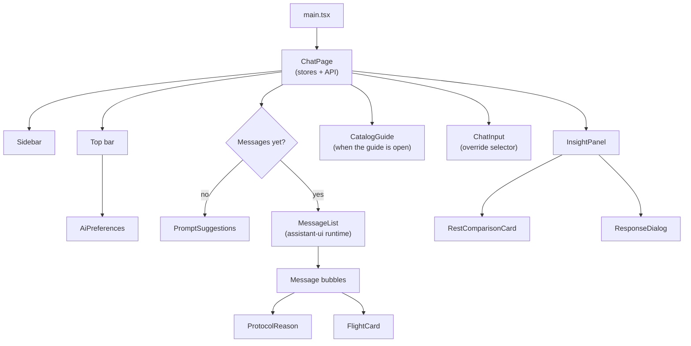
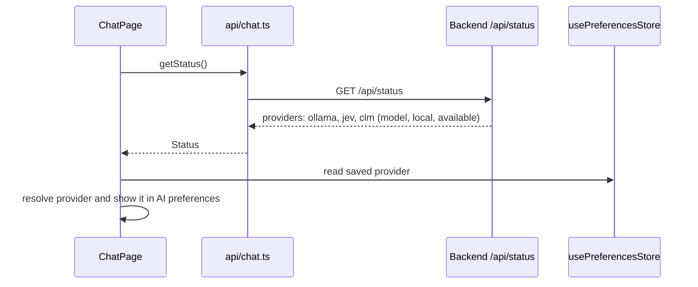
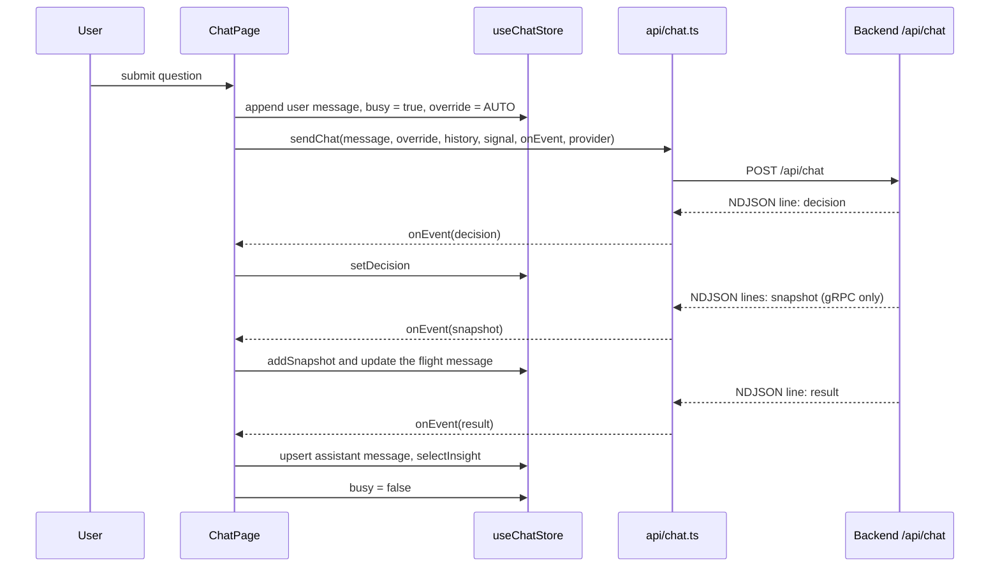
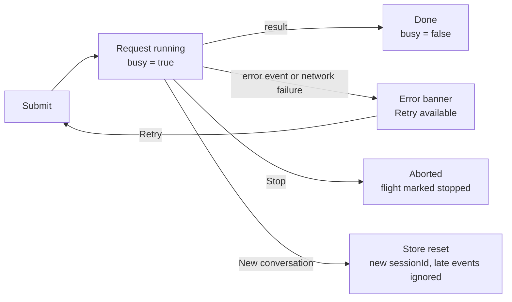
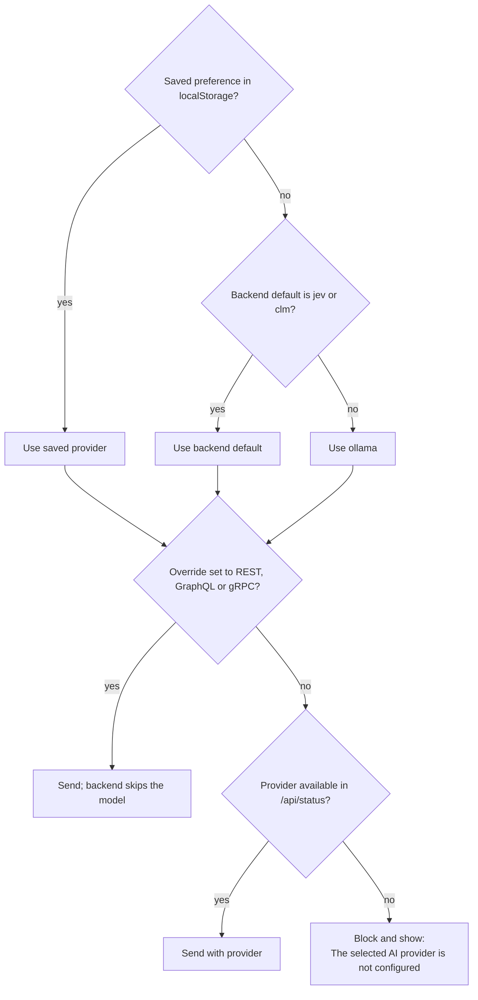

# Protocol Studio Frontend Study Guide

This guide explains how the Protocol Studio frontend is built, how data from the backend flows into the screen, how the user chooses between the Ollama, Jev and CLM routers, and what the frontend needs when Jev or CLM is configured. It is written for developers who are new to the codebase. A companion guide, `study-guide-backend.md`, covers the server side.

The frontend is a single-page React application. The user asks a question in plain language, the backend picks an operation and protocol, and the frontend streams the decision, any gRPC updates and the final answer into a chat. A Protocol insight panel shows exactly what was sent and received, including how much the same data would have cost over REST.

> [!NOTE]
> The frontend never talks to Ollama, Jev or CLM directly, and never sees an API key. It sends questions to `/api/chat` and reads provider availability from `/api/status`. Everything AI-related happens on the backend.

## 1. How the frontend was built

### Technology stack

| Technology | Version | Role in the frontend |
|---|---|---|
| React | 19 | UI components, rendered in `StrictMode`. |
| TypeScript | 6 | Typed components, API payloads and stores. |
| Vite | 8 | Dev server on port 5173 and the production build. Proxies `/api` to `http://localhost:8080` in development. |
| Zustand | 5 | Application state: one chat store and one persisted preferences store. |
| assistant-ui | 0.15 | Chat thread primitives: auto-scrolling viewport and running state. |
| Tailwind CSS | 4 | Utility styling through the Vite plugin, alongside hand-written CSS in `index.css`. |
| Radix UI (Dialog, Select, Slot) | latest 1.x and 2.x | Accessible dialogs and the protocol override selector. |
| class-variance-authority, clsx, tailwind-merge | — | The shadcn/ui button pattern and class merging. |
| lucide-react | 1.x | Icons. |
| Vitest, Testing Library, jsdom | 5, 16, 30 | Component, page, store and API tests. |
| ESLint and Prettier | 10 and 3 | Linting, including the architectural import boundary, and formatting. |
| nginx (unprivileged) | 1.28 | Serves the built app in Docker and proxies `/api/` to the backend. |

### Project layout

| Path | Responsibility |
|---|---|
| `src/main.tsx` | Entry point. Renders `ChatPage` inside `React.StrictMode`. |
| `src/pages/ChatPage.tsx` | The only page and the only module that touches stores and API clients. Owns submit, cancel, reset and layout. |
| `src/api/chat.ts` | `getStatus()` and `sendChat()`. Parses the NDJSON stream into typed events. |
| `src/store/useChatStore.ts` | Conversation, protocol and session state, in three slices. Never persisted. |
| `src/store/usePreferencesStore.ts` | The selected AI provider, persisted to `localStorage` under `protocol-studio-preferences`. |
| `src/types.ts` | Shared types mirroring the backend records: `Decision`, `Exchange`, `RestComparison`, `Insight`, `TrackSnapshot` and more. |
| `src/components/Sidebar.tsx` | Workspace navigation, protocol legend, local-model card and field guide link. |
| `src/components/AiPreferences.tsx` | The provider picker dialog in the top bar. |
| `src/components/InsightPanel.tsx` | The Protocol insight panel: route diagram, metrics, REST comparison and payload tabs. |
| `src/components/ResponseDialog.tsx` | Full-screen view of a captured response with copy. |
| `src/components/ProtocolBadge.tsx`, `ProtocolReason.tsx` | Protocol pill and the "Why this protocol" callout. |
| `src/components/CatalogGuide.tsx` | The dataset and demo field guide view. |
| `src/components/chat/MessageList.tsx` | The chat thread, built on assistant-ui's external store runtime. |
| `src/components/chat/ChatInput.tsx` | Text input, send and stop, and the "Force REST / GraphQL / gRPC · next question" selector. |
| `src/components/chat/PromptSuggestions.tsx` | The three starter cards shown before the first question. |
| `src/components/chat/FlightCard.tsx` | Live rendering of the simulated Falcon flight from gRPC snapshots. |
| `src/components/ui/` | shadcn-style primitives: `button`, `dialog`, `select`. |
| `src/lib/protocols.ts`, `src/lib/utils.ts` | Protocol labels and the class-name helper. |
| `src/index.css` | Tailwind import and all component styles. |
| `src/test/` | Test setup and shared fixtures. |
| `vite.config.ts`, `eslint.config.js`, `nginx.conf`, `Dockerfile` | Build, lint, serving and container configuration. |

### Component tree

### Rules the code follows

| Rule | Where it is enforced | Why it exists |
|---|---|---|
| Only pages may import stores or API clients. | ESLint `no-restricted-imports` on `src/components/**` and `src/lib/**` | Components stay presentational: props in, callbacks out. They are easy to test and reuse. |
| Stores may not import API clients. | ESLint rule on `src/store/**` | State does not perform network calls; the page orchestrates both. |
| Conversation history is never persisted. | `useChatStore` has no persistence | Refresh or "New conversation" clears the session. Nothing sensitive is stored in the browser. |
| Only the provider choice is persisted. | `usePreferencesStore` `partialize` | The preference survives reloads, but invalid saved values are discarded on load. |
| Stale responses cannot modify a new conversation. | `sessionId` check in `ChatPage` | A late event from a cancelled or reset request is ignored. |
| An override applies to one question only. | `ChatPage.submit` resets to `AUTO` | Presenters cannot accidentally leave a forced protocol on. |
| Failures never fall back silently. | `ChatPage` shows the error banner with Retry | The user always knows when routing did not happen. |
| Coverage must stay at or above 80%. | Vitest thresholds for lines, statements, functions and branches | Changes ship with tests. |

### Build and quality gates

| Command (from `frontend/`) | What it checks |
|---|---|
| `npm run dev` | Starts Vite on `127.0.0.1:5173` with the `/api` proxy. |
| `npm run lint` | ESLint, including the import boundary rules. |
| `npm run format:check` | Prettier formatting. |
| `npm test` | Vitest with coverage thresholds. |
| `npm run build` | Type check (`tsc -b`) and production build. |
| `docker compose build frontend` | Runs lint, format check, tests and build inside the image before packaging. |

## 2. How data flows from the backend to the frontend

### On page load

`ChatPage` calls `getStatus()` once when it mounts. The status lists every provider with its model, whether it is local, and whether it is configured on the backend. The page combines this with the saved preference to decide which provider the next question will use.

> [!NOTE]
> Status is fetched only on mount. After the backend configuration changes, refresh the page so the UI sees the new availability.

### Sending a question

When the user submits, `ChatPage` checks that the selected provider is available (unless an override is set), appends the user message, marks the store busy and calls `sendChat()`. The request carries the message, the provider, the override (or `null` for automatic routing) and up to the last 20 messages, each truncated to 4,000 characters.

### Reading the stream

`sendChat()` reads the response body with a stream reader and a text decoder, splits it on newlines and parses each complete line as JSON. Every event is handed to the page through the `onEvent` callback as it arrives. An `error` event throws, which the page turns into the error banner. If the stream ends without a `result`, that is also treated as an error.

| Event | What the page does |
|---|---|
| `decision` | Stores the decision so the insight panel can highlight the chosen protocol while the call is still running. |
| `snapshot` | Adds the snapshot to the live list. Flight snapshots create or update the assistant message with a streaming `FlightCard`. |
| `result` | Writes the final assistant message with its answer and insight, and selects that insight in the panel. |
| `error` | Shows the message in the error banner with a Retry button. |

### What the chat store holds

| Slice | State | Used for |
|---|---|---|
| Conversation | `messages`, `busy`, `error`, `snapshots` | The thread, the running indicator, the error banner and live gRPC updates. |
| Protocol | `override`, `decision`, `selectedInsight` | The override selector, the in-flight decision and the insight shown in the panel. |
| Session | `sessionId`, `reset()` | Guarding against stale events and starting a new conversation. |

### How the payload becomes the screen

| Backend field | Where it appears |
|---|---|
| `answer` | The assistant message text in `MessageList`. |
| `insight.decision.protocol` | The highlighted protocol in the route diagram and the message badge. |
| `insight.decision.operation` | The operation name the router chose, for example `FILM_SHIPS_CREW`. |
| `insight.decision.source` | "Intent classifier" line in the route diagram, and MODEL SELECTED or PRESENTER SELECTED. |
| `insight.decision.reason` | The "Why this protocol" callout. |
| `insight.decision.classification` | The Decision tab, including Jev or CLM confidence and probabilities. |
| `insight.exchange.request` / `response` | The Request and Response tabs, and the expanded Response details dialog. |
| `insight.exchange.operation` | The operation line, for example `GET /api/catalog/films/1` or `query FilmShipsCrew`. |
| `insight.exchange.responseBytes`, `durationMs` | Response body and protocol time metrics. |
| `insight.exchange.comparison` | The SAME DATA OVER REST card: request counts, byte totals and the REST calls (GraphQL only). |
| `insight.timings` | Routing time and total server time metrics. |

> [!TIP]
> The REST comparison is measured on the server with real REST calls, not estimated in the browser. For "Which starships appear in A New Hope, and who flew them?" it shows one GraphQL request of about 545 bytes against two REST requests of about 5,400 bytes.

### Cancelling, resetting and retrying

Each request gets its own `AbortController`. Stop aborts the fetch and marks a streaming flight as stopped. New conversation cancels any request, resets the store and creates a new `sessionId`, so late events from the old request are ignored. Retry resubmits the last question. The override selector always returns to Auto after a question is sent.

### Serving in development and in Docker

| Mode | URL | How `/api` reaches the backend |
|---|---|---|
| Native development | `http://localhost:5173` | Vite proxies `/api` to `http://localhost:8080`. |
| Docker Compose | `http://localhost:3000` | nginx proxies `/api/` to `http://backend:8080` with buffering off and a 180 s read timeout, so NDJSON streams arrive line by line. |

## 3. Ollama, Jev and CLM in the frontend

The frontend treats the three routers as interchangeable providers. The user picks one in **AI preferences**; the choice applies to the next question immediately, without a restart, and is remembered in the browser.

| | Ollama | Jev | CLM |
|---|---|---|---|
| Badge in AI preferences | LOCAL | HOSTED | SELF-HOSTED |
| Description shown | Runs on your machine. No cloud API key needed. | TypeSafe's structured classification service. Requires internet and a configured API key. | Structured decisions on your configured CLM server. Can run locally or on your own remote server. |
| Enabled when | The backend reports `available: true` (always, by default) | The backend has `TYPESAFE_API_KEY` | The backend has `CLM_URL` |
| Confidence in the Decision tab | Not reported | Yes, per question | Yes, per question |
| Typical routing time | About 1 to 4 s warm, longer cold | Depends on network | Depends on server |

### How the provider is resolved

> [!WARNING]
> The saved preference wins over the backend default. If a browser saved Jev and that backend has no Jev key, every automatic question is blocked until you pick another provider or clear `protocol-studio-preferences` from `localStorage`.

### Presenter overrides

The selector in `ChatInput` offers Auto plus "Force REST · next question", "Force GraphQL · next question" and "Force gRPC · next question". An override bypasses all providers, works even when none is configured, and is labelled PRESENTER SELECTED in the insight panel. It resets to Auto as soon as the question is sent.

## 4. Configuring Jev and CLM

Jev and CLM are configured entirely on the backend. The frontend needs no build flags, environment variables or keys; it only needs a page refresh to read the new status. The backend guide has the full reference, and the steps below are the end-to-end path a frontend developer follows.

### Enable Jev

| Step | Where | Action |
|---|---|---|
| 1 | Repository root | Add `TYPESAFE_API_KEY=your-key` to `.env` for Docker, or to `.env.native` for native development. |
| 2 | Terminal | Docker: `docker compose up -d --force-recreate backend frontend`. Native: restart `npm run dev`. |
| 3 | Browser | Refresh the page so `/api/status` is fetched again. |
| 4 | AI preferences | Choose **Jev**. It is selectable only when the backend reports it available. |
| 5 | Chat | Click a starter card and open the Decision tab to see Jev's choice and confidence. |

### Enable CLM

| Step | Where | Action |
|---|---|---|
| 1 | Your CLM host | Start the CLM server and its Qwen3-8B encoder. |
| 2 | Repository root | Set `CLM_URL` in `.env` (Docker: `http://host.docker.internal:8700`) or `.env.native` (native: `http://127.0.0.1:8700`). Add `CLM_API_KEY` only if the server requires it. |
| 3 | Terminal | Recreate the containers or restart the native backend. |
| 4 | Browser | Refresh, then choose **CLM** in AI preferences. |
| 5 | Chat | Ask a question and confirm the source line reads "CLM · clm-latest". |

> [!IMPORTANT]
> "Available" means configured, not reachable. If the key is wrong or the server is down, the provider still appears selectable and the first question shows an error banner. Check the backend logs and the configuration, then retry.

### Verify from the frontend

| Check | Expected result |
|---|---|
| Open `/api/status` in the browser | The provider shows `available: true`. No URL or key appears. |
| AI preferences | The provider is selectable and shows its badge. |
| Ask "Who is the cast in A New Hope?" | REST, operation `FILM`, target `film:1`, a cast-only answer. |
| Ask "Which starships appear in A New Hope, and who flew them?" | GraphQL, operation `FILM_SHIPS_CREW`, and a SAME DATA OVER REST card. |
| Decision tab | Jev and CLM show confidence and probabilities; Ollama shows the raw tool call. |

### Troubleshooting

| Symptom | Likely cause | Fix |
|---|---|---|
| "The selected AI provider is not configured" | The saved provider is unavailable on this backend. | Choose another provider, or configure it on the backend and refresh. |
| Provider still disabled after configuring | The page has not re-read the status, or the container was not recreated. | Recreate the containers, then refresh the page. |
| "Backend unavailable" in the top bar | The backend is not running or not reachable through the proxy. | Start the backend; use port 5173 natively and 3000 in Docker. |
| Answer arrives all at once instead of streaming | A proxy is buffering the NDJSON response. | Keep `proxy_buffering off` in `nginx.conf` for `/api/`. |
| The route looks wrong | The router chose an unexpected operation. | Check the Decision tab and the source line; an override shows PRESENTER SELECTED. |
